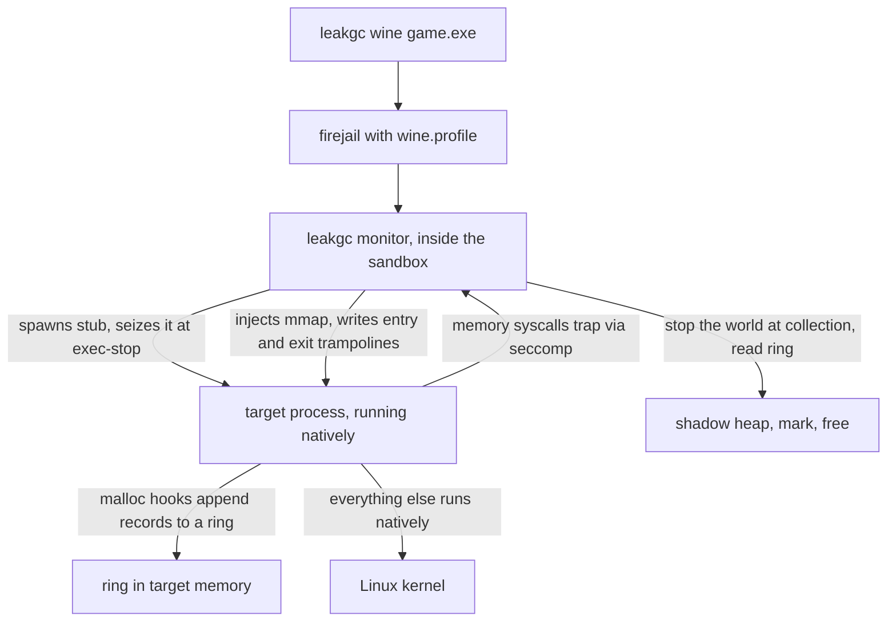

# leakgc: architecture plan (v3, proposal)

Status: **PLAN v3. The goal is a live garbage collector that frees leaked memory in a running program (D40); the exit-style report is a diagnostic.** Done: P1 (GC core), P2a (supervisor and trap), P2b-1 to P2b-3a (hooks and ledger for static single-threaded glibc), P4a (pure conservative marker over supplied snapshots), P4b (report-only reachability at each trapped call, for single-threaded static processes, section 7h), and the read-only roots of P4b (D51, section 7i). The count trigger (D53) and the calloc-family hooks (D54) are built (section 7k). `posix_memalign` and `malloc_trim` are hooked (R39), and a hooked call made while another is open is recorded as `Kind::Nested`, which makes the ledger untrusted (R40, and D56(b) for calls from inside the open entry) (section 7l). P5 (freeing, section 7m) is built for static single-threaded glibc. Not built: threads (P2b-3b, D52) and `--report-only` (P7). Freeing is on by default, so **freeing is live for the programs P5 covers**. Spikes P0-b (section 7a) and P0-c (section 7b) are done. Decided since: D1 (the Win32 heap is hooked at the PE boundary, not built, spike recorded) and D42 (collection is count-based mark and sweep, as in the OCaml oracle). Open items are in section 9.
Supersedes the architecture sections of `HANDOVER.md` (left untouched).
No push. Each phase is its own commit, gated by `cargo xtask lint` and `cargo xtask coverage`.
Spikes live in `spikes/` (git-excluded, throwaway, not covered by the gate).

## 1. What changed from HANDOVER.md (and from v1)

| Area | Old (HANDOVER) | v3 (this plan) |
|---|---|---|
| Interposition | LD_PRELOAD / libc malloc | Dropped. Works for static binaries and for allocators that bypass the dynamic linker. |
| Launcher role | Spawns child | Process supervisor. Owns the child tree's memory syscalls and allocator entry points, and passes everything else through to the kernel. |
| Where the supervisor runs | Not considered | **Inside the Wine sandbox** when Wine is firejail-wrapped (D15). Verified: an outside supervisor cannot trace a firejail sandbox. |
| Object boundaries | Manual `alloc` calls | Observed from allocator entry points (malloc family), per family. |
| Roots | Manual `add_root` | Conservative: registers, stacks, writable memory (Boehm / Valgrind "still reachable" style). |
| Default behaviour | Auto-free | **Free leaked memory in the running process — the purpose of the tool (D40).** The exit-style report is a diagnostic, not the product. Freeing uses a safe point (4.3) and always-on quarantine, under the conservative-free safety rules (R2, R3, D41). |
| Rust | Safe launcher | `#![forbid(unsafe_code)]` in all our crates. Verified in the spike. Dependencies do contain unsafe (section 8, R7). |
| Process lifecycle | Not considered | Supervisor drains every tracee before exiting, and always resumes or kills the stub on error (4.4). Learned from spike failures. |

Honest scope note: "like a VM" here means the supervisor owns the child's memory syscalls and allocator entry points, and reclaims the memory the program leaks. It is **not** a hardware VM and it is **not** an emulator. The child runs on the real Linux kernel, with the real GPU, at near-native speed. If you need literal VM semantics, that is option E1 (D17).

## 2. Research findings (verified vs. not verified)

- **Cosmopolitan Libc** (ISC): **verified, and the answer is no.** Its README and its strace implementation (`--strace` / `--ftrace`, in `libc/intrin/strace*` and the `sys_*` wrappers) only log calls made by Cosmopolitan's own runtime. It does not intercept syscalls from foreign code, so it cannot be used for Wine, games, or prebuilt binaries. Its APE format runs natively on several OSes, which is a different feature. I know you expected it to be the mechanism. It is not.
- **Blink** (`jart/blink`, ISC): **verified from its README.** A user-mode x86-64 interpreter. It runs static and dynamic Linux ELF. Every `SYSCALL` goes through the emulator (`-s` logs them). It is the only existing "VM that sees every instruction and memory access". Costs: no GPU, Linux 4.5 personality, 500+ instructions and 150+ syscalls implemented, C, and no hook for allocation boundaries (it would need a patched fork). See D17.
- **Wine's `ntdll.dll`** exports `RtlAllocateHeap`, `RtlFreeHeap`, `RtlReAllocateHeap`, `RtlSizeHeap` (checked earlier with `x86_64-w64-mingw32-objdump -p`). The Win32 heap can be identified by name. Hooking it is D1 (decided). The Wine version is not known: `wine --version` prints only the firejail banner, because `/usr/local/bin/wine` is the wrapper. The exports were read from the installed `ntdll.dll` files under `/usr/lib/wine`.
- **relibc** (MIT, Rust): **verified in P0-b.** It builds as a static libc. The malloc family is exported unprefixed and survives into the static binary. It is a test target only (D13). It pins `nightly-2026-05-24`.
- **Installed allocators (verified on this machine, symbols checked with `nm -D --defined-only`).** gperftools 2.18.1 (four tcmalloc variants, same exports), oneTBB 2.19 (`libtbbmalloc` exports `scalable_*` only, `libtbbmalloc_proxy` overrides the malloc family), jemalloc 5.4.0, mimalloc 3.5 (`mi_*` plus malloc overrides), musl 1.2.6 (`/usr/lib/musl/lib/libc.so`), Boehm `gc` 8.2.12 (`GC_malloc`, does not override malloc), and LLVM compiler-rt 23 with Scudo standalone (overrides malloc) and LeakSanitizer (`.a` only). `talloc` (Samba's pool library) and `libionic` (owned by `rdma-core`) are not allocator families and are excluded.
- **Valgrind** is still the ground truth. memcheck reports 64 bytes definitely lost on the dynamic build of a test program, and "no leaks are possible" on the static build of the same program. That silent miss is the failure mode this design must never repeat.
- **Environment (verified):** Linux, `ptrace_scope=1`. LSMs active: `capability, landlock, lockdown, yama, bpf` (no AppArmor). firejail 0.9.80 is what `/usr/local/bin/wine` is (a symlink). It picks `/etc/firejail/wine.profile` by program name. That profile sets `allow-debuggers`, `noroot`, `nonewprivs`, `caps.drop all`, `seccomp`, `restrict-namespaces`.

## 3. Execution engine options

| Option | Static binaries | Allocator-agnostic | Sees every memory access | GPU works | Speed | Notes |
|---|---|---|---|---|---|---|
| **E1** Emulator (Blink-style) | yes | yes, with adapters | yes | no | roughly 10x or worse | The only literal "VM". Good oracle for hard cases. C dependency. |
| **E2** Supervisor (seccomp TRACE + ptrace + int3 probes) | yes | yes, with adapters | at memory syscalls and probes only | yes | near native (about 27 µs per trap, see 7a) | Former recommendation, now the fallback (D17). Verified end to end. Not a VM, and I want to be clear about that. |
| **E3** Hardware VM (KVM guest with Linux and Wine) | yes | yes, with adapters | yes (EPT / introspection) | no (unless passthrough) | near native CPU | Heavy: needs a guest image. Hard GPU story. |
| **E4** Rust monitor, native execution, allocation hooks and memory-syscall trap. No instruction interpretation (Blink-style structure only). | yes | yes, for identified allocators, same limits as E2 | at allocator entry points and memory syscalls only | yes | near native, about 35 ns per hooked call (7b) | Chosen by the user (D17). Validated for single-threaded static glibc in P0-c (7b). Threads, dynamic and stripped binaries are not validated yet. |

**Status (D17): E4 chosen by the user, validated for the single-threaded static case (P0-c).** E2 remains the fallback if a remaining gate fails (threads, dynamic linking, or self-checking code, see 7b).

## 4. Recommended architecture (E4)

If Wine is not sandboxed, the `firejail` box is simply removed. The supervisor then runs at the top level.

### 4.1 Components

1. **Stub and launch (verified).** The supervisor spawns `leakgc __stub <target> [args]`. The stub builds the seccomp filter (all CStrings and argv are built before the filter is installed), calls `apply_filter`, raises `SIGSTOP`, and then `execv`s the target. The supervisor waits for the stub's group-stop (polling `/proc/<pid>/stat` for state `T`), then calls `PTRACE_SEIZE` with `TRACESECCOMP | TRACEEXEC | TRACECLONE | TRACEFORK | TRACEVFORK | EXITKILL`, and then `SIGCONT`. We do **not** use `PTRACE_TRACEME` (it would have the tracer be the child, and it makes the exec-trace logic harder). Filters survive `execve`.
2. **Syscall filter.** The spike traps `mmap` only, using `SECCOMP_RET_TRACE`. The P2 plan is to add `munmap`, `mremap`, `mprotect`, `madvise`, `brk`, `clone`, `clone3`, and `execve`. Each addition is measured in P2 against the cost in 7a. Everything not on the list runs natively at full speed.
3. **Memory map.** `/proc/<pid>/maps` gives the writable regions (the spike reads it and counts `rw` mappings). File-backed `MAP_SHARED`, device (`/dev/dri`, `/dev/nvidia*`) and SysV shm mappings are excluded from the heap and from scanning (R3).
4. **Hooks (E4).** At exec-stop, the monitor injects an `mmap` into the target (RWX, within 2 GB of the allocator) and writes an entry trampoline and an exit stub there. It replaces the first 5 bytes of each hooked allocator entry point (after `endbr64`) with a `jmp rel32` to the entry trampoline. Displaced instructions are re-encoded at the trampoline address with iced-x86 (4.6). The entry trampoline saves the caller's return address in a pending table keyed by the caller's rsp, and replaces it with the exit stub's address. The exit stub writes the returned pointer into the ring record and jumps back. The target never stops per call. Measured: about 35 ns per hooked call (7b). The E2 int3 probes from P0-b (7a) remain only as a per-family fallback (4.6). Their lessons still apply: glibc's `free` tail-jumps to its own entry, so a free hook must dedupe re-entries by (rsp, return address) or it over-counts. Pre-main allocations are real (7a), so hooks must be in place before `main`.
5. **Shadow heap.** Built only from ring records: `(family, returned address, requested size, call site)`. The usable size comes from the family's adapter, not from the record. An interval map, so interior pointers resolve to the containing block. It does not read allocator internals. The map logic is allocator-agnostic. The hooks are not: each family still needs its entry points (item 9).
6. **Stop the world.** `PTRACE_INTERRUPT` (or `SIGSTOP`) on every thread, then `PTRACE_GETREGS`. Ring records are read only in this state, so the reader never races a writer. Open: a thread stopped between its `lock xadd` and its record store leaves one slot unwritten. Records need a validity marker written last. The spike's 32-byte record has a spare `pad` field that could hold it (not validated, R22).
7. **Roots and mark.** Conservative roots: all registers of all threads, all thread stacks, all other writable mappings, excluding known-free blocks. Every word inside a live block's `[start, start+usable)` marks it (interior pointers count). Iterative tri-color worklist, as in the OCaml prototype.
8. **Sweep and free.** Unmarked blocks are leaks. The collector frees each one by calling the family's `free` inside the child at a safe point (4.3), under quarantine (P5). The optional diagnostic report groups the same blocks by call site (the hook's return address, symbolised when possible). Freeing is the product; the report is a view onto it.
9. **Allocator adapters.** A family is a table of symbol names plus a usable-size function. Discovery reads `.dynsym` and `.symtab` of every loaded ELF object. Stripped static binaries have no names, so they are detected but not supported until a signature mode exists (later phase). A recognised family whose entry points cannot be resolved is **fail-closed**: its blocks are never freed.
10. **Install point.** Verified for static non-PIE glibc at exec-stop (7b). Hooks must be installed again after every `execve`, because a new image has no hooks. Dynamic and PIE binaries map libc later, so they need a second install point after the library's executable mapping appears. Not built. This is the first task of P3. The `ntdll` hooks (D1) need the same second install point, because Wine maps `ntdll.dll` at runtime.
11. **Ring and pending table.** The ring is 2^20 records of 32 bytes in target memory, with the head advanced by `lock xadd`. The pending table is keyed by the caller's rsp. In the spike it is global and unsynchronised, so the design is valid only for single-threaded targets until R16 is solved. Ring overflow is R21.

### 4.2 Why this shape

- Works for static binaries, because it hooks the process directly and does not depend on the dynamic linker. Verified for static non-PIE glibc (7b).
- Works for Wine and for the Rust port, because it sits below both, at the allocator and syscall boundary. Wine is an argument, not a dependency.
- Keeps our code safe. Ptrace, seccomp and `/proc` are reached through crates (`nix`, `seccompiler`), and displaced-instruction relocation goes through `iced-x86`. Our code contains no `unsafe` (verified). The crates do contain unsafe (R7).
- Near native, with no per-call stop. A hooked `malloc` costs about 35 ns (7b). An E2 seccomp trap costs about 27 µs (7a). E2 int3 probes were never timed on their own, and each needs at least two stops per call (entry and return), so the comparison is an estimate.

### 4.3 Safe point and free injection

A block may only be freed when:

1. Its family is supported, and its entry points resolved.
2. It is unmarked after a full scan (no word in any root points into it, interior pointers included).
3. **No thread is inside a hooked call.** The pending table shows it: we saw the entry and have not yet seen the exit. If any thread has a pending entry, the collection is skipped and retried.
4. The freeing happens by injecting a call to the family's `free` into one stopped thread: save registers, set up a scratch return address on a page we own, call, restore. This is the gdb "inferior call" technique.

Residual risk: a thread can hold an allocator lock inside a function we did not hook. See R1.

### 4.4 Process lifecycle rules (learned from the P0-b spike)

These are requirements, not suggestions. Each one came from a failure we actually hit.

1. **Drain before exit.** Keep servicing ptrace events until `waitpid` returns `ECHILD`, even after the root has exited. Wine leaves `wineserver` running. If the supervisor returns early, its tracees either get `ENOMEM` from `ld.so` (no `EXITKILL`, the trap has no tracer and returns an error) or are killed by `EXITKILL`, which made the whole sandbox report exit 137 on a successful run.
2. **Never leave a stub stopped.** If the supervisor fails after the stub self-stops, the stub stays in group-stop forever. In the spike this hung the firejail monitor waiting on it. Every error path must `SIGCONT` the stub, or `SIGKILL` it. This is a `Drop` guard in P2.
3. **Exit code.** The root's exit code (or `128+sig`) is the exit code of `leakgc`, and it is reported only after the drain completes.
4. **Fail-closed on supervisor death.** `EXITKILL` ensures the traced tree dies with the supervisor. Without a tracer, a trapped `mmap` returns `ENOSYS`, so the program sees an allocation failure rather than silently running untracked. This is the mmap trap window: keep the code between `apply_filter` and the stop free of allocation (verified: the window is only the `raise`).

### 4.5 Wrapper placement (D15)

The real `wine` is a firejail sandbox, and that changes where the supervisor has to run.

- A supervisor **outside** the sandbox cannot seize a process inside it. Verified: `PTRACE_SEIZE` returns EPERM, with yama descendant checks satisfied. Strong inference (not proven in kernel source): firejail puts the sandbox in a child user namespace (`uid_map` is `1001 1001 1`), and Linux refuses a cross-namespace ptrace unless the tracer has `CAP_SYS_PTRACE` in the child's namespace. `strace` fails the same way.
- A stub that installs seccomp **and then** runs firejail fails. `seccompiler` sets `NO_NEW_PRIVS`, and firejail's setuid exec then fails with a lockfile error (verified earlier).
- A supervisor **inside** the sandbox works. Verified: the spike, run inside `firejail --profile=/etc/firejail/wine.profile`, seizes its own stub and runs real Wine (hello and `cmd`) to exit 0, with output intact.
- A plain firejail (no profile) blocks `ptrace` with EPERM in its default seccomp filter. `wine.profile` allows it with `allow-debuggers`. The profile must keep that line.

So the launch becomes: `leakgc wine game.exe` → (configured wrapper) `firejail --profile=/etc/firejail/wine.profile leakgc __supervise wine game.exe`. The wrapper is configuration (D15), and `leakgc` must know it.

### 4.6 Hook mechanics and fallback

Install sequence (static non-PIE, verified in 7b):

1. Stop at exec-stop. Burn one `PTRACE_SINGLESTEP` before any injected syscall. Without it the injected `syscall` silently does not run (`rip` unchanged, `rax` 0).
2. Inject `mmap` (RWX, hint near the allocator, so a `jmp rel32` can reach the trampoline).
3. Write the entry trampoline, the exit stub, the ring and the pending table through `/proc/<pid>/mem`.
4. Write the 5-byte patch last. No thread may execute a half-written trampoline.

Refusal rules. Each rule refuses one entry point, which then stays fail-closed (its blocks are never freed):

- Another branch in the function targets a byte inside the 5 patched bytes (R19).
- An instruction in the displaced bytes cannot be decoded, or cannot be relocated correctly.
- The displaced instructions do not cover 5 whole bytes, so the patch would split an instruction or overlap the next function.

Decoding: the monitor decodes instruction lengths and the operands needed to relocate the displaced instructions. It executes nothing and does not interpret what the instructions do. This is the answer to open question (3) in D17.

Entries: as built (sections 7k and 7l), all ten glibc entry points are hooked: `malloc`, `free`, `realloc`, `calloc`, `memalign`, `aligned_alloc`, `valloc`, `pvalloc`, `posix_memalign` and `malloc_trim`. `posix_memalign` returns its pointer through an argument, so its exit stub stores the block it wrote (R39). Re-entry is handled by a shared depth counter, not by the (rsp, return address) test first proposed here. A hooked call made from outside an open entry's own code is recorded as `Kind::Nested` (R40). A call made from inside it is not recorded (R41). An unhooked entry's blocks are not seen. A block whose free is not seen looks live and is never freed, so the report must say the family is only partly covered.

Fallback per family: if the hooks cannot be installed, the family uses the E2 int3 probes (7a), or it is reported as not covered.

Process tree (design, not tested): a forked child inherits the hooks and the ring mapping, copy-on-write. Each process is its own tracee. The monitor resets the child's ring head and pending table at its fork-stop, and reads each process's ring separately. Threads share one ring and need per-thread pending state (R16).

### 4.7 What E4 removes compared with E2

- The per-call stops for allocator calls. The target keeps running between hooks.
- The ptrace round trip for each call. The ring is read at collection time only.

What E4 adds: code patching (R17, R18, R19), instruction relocation, and new races (threads, install points, re-install after `execve` and fork).

Unchanged: memory syscalls still trap through seccomp (D16, D18).

### 4.8 Collection trigger and pacing (live process)

**Decided by the user (D42): mark and sweep, paced exactly like the OCaml oracle** (`ocaml/leakcheck.ml`, ported in `src/gc/alloc.rs`). Volume, memory-pressure and timer triggers were proposed and rejected.

The rule, as the oracle implements it:

1. Every allocation increments a counter, `allocs_since_gc`.
2. When the counter reaches `collect_every` (oracle value 64, `COLLECT_EVERY`), it resets to 0 and a **full cycle** runs: mark from the roots (4.1 item 7), sweep every unmarked block, free the leaks (4.3).
3. The cycle runs **before the new block is registered.** The new block is not rooted yet, so a cycle after registration would sweep the block this call is about to return. This ordering is part of the design.

What it means for the live process (design, not built):

- The allocation hook counts allocating calls. On the call that reaches the threshold, the thread stops at the **entry** of that call, before the original allocator runs, so the new block does not exist yet. That is the live analog of rule 3. The monitor runs the cycle (stop the world, drain the ring, mark, sweep, free) and resumes the thread.
- How the hook counts and how it stops is a P4/P5 design item: a counter in the entry trampoline or a count of ring records in the monitor, and an `int3` or a trapped syscall to stop. It must also be reconciled with the safe-point rule in 4.3 (item 3: no thread inside a hooked call).
- `collect_every` is a parameter. 64 is the oracle's value, and the tests use it. The value for a live process is not set. It is configurable (P7) and chosen by measurement.

Cost, stated plainly (R27): a cycle stops every thread and scans every writable mapping, and it runs every N allocations. N = 64 is cheap on the oracle's toy heap. On a real game heap that allocates often, it would be a full scan many times per second, which is very likely unusable, so the live N is expected to be much larger than 64. That is an inference, not a measurement. Making each cycle cheaper (incremental or generational scanning) is later work and does not change the trigger.

**Status (D53, built; section 7k):** checks run only at trapped calls and forks, and only while the process is single-threaded. The trigger does not stop a thread at allocation entry. Each process counts its applied non-free records, and once the count reaches N (`COLLECT_EVERY`, 64 for now), the next trapped call runs the check. Forks are checked whatever the count (D47).

## 5. Roots and what counts as "reachable"

For the GC, "reachable" is a binary verdict: a block the scan does not mark is freed, a block it marks is kept. The Valgrind-style categories below (definitely, indirectly, possibly lost, still reachable) are a **diagnostic grouping** of what was or was not freed, not separate behaviours.

- Reachable = marked by a conservative scan. A word that merely looks like a pointer keeps a block alive. This is the **safe** direction: false retention means a leak goes unreported. A false free means a crash, so we never take that risk silently.
- **Unknown allocators** (a region of writable memory that no family owns) are treated as roots. Blocks they point to are reported as "still reachable", not "definitely lost". Nothing inside an unknown region is ever freed.
- Report categories follow Valgrind: definitely lost, indirectly lost, possibly lost, still reachable, and "not covered" (bytes under an unsupported allocator).

As built (sections 7h and 7i), the roots are the registers, every writable mapping, every readable non-executable mapping except the kernel's `[vvar]` pages (D51), and the 128-byte red zone below rsp, minus the hook region and the outstanding blocks. Executable mappings are not roots (R35).

## 6. Allocator coverage plan

| Family | Entry points | Test link modes |
|---|---|---|
| glibc | `malloc`, `free`, `calloc`, `realloc`, `memalign`, `posix_memalign`, `aligned_alloc`, `malloc_usable_size`, plus `__libc_*` variants | dynamic, static (with symbols), static stripped |
| mimalloc (installed, v3.5.4) | `mi_malloc`, `mi_free`, `mi_realloc`, `mi_calloc`, `mi_usable_size`, plus unprefixed overrides in `libmimalloc.so.3` | dynamic (`/usr/lib/libmimalloc.so.3`), static (source build, see 7a) |
| jemalloc (installed) | unprefixed `malloc` family, `malloc_usable_size`, `mallctl` (not used for tracking) | dynamic, static |
| gperftools tcmalloc 2.18.1 (installed): `libtcmalloc.so.4.6.5`, `libtcmalloc_minimal.so.4.6.5`, `libtcmalloc_debug.so.4.6.5`, `libtcmalloc_and_profiler.so.4.7.5` | `malloc` family (unprefixed), `tc_malloc`, `tc_malloc_size` for usable size. All four export the same set. | dynamic, one test row per variant (each is a separate build, so each is tested) |
| oneTBB tbbmalloc 2.19 (installed): `libtbbmalloc.so.2.19` | `scalable_malloc`, `scalable_calloc`, `scalable_realloc`, `scalable_free`, `scalable_posix_memalign`, `scalable_msize` for usable size. Not a malloc override. | dynamic, linked directly |
| oneTBB malloc proxy (installed): `libtbbmalloc_proxy.so.2.19` | `malloc` family (unprefixed), as a malloc override | dynamic, preloaded by the test program |
| Scudo standalone (LLVM compiler-rt 23, installed): `libclang_rt.scudo_standalone-x86_64.so` | `malloc` family (unprefixed), `malloc_usable_size` | dynamic. Static `.a` exists but is not verified. Hardened, so a good stress target. |
| Boehm GC `gc` 8.2.12 (installed): `libgc.so.1.5.6` | `GC_malloc`, `GC_free`, `GC_init`. Does not override malloc. | **Covered, report-only (D19).** Boehm frees its own unreachable memory, so leakgc never frees its blocks. Reports for Boehm-managed blocks are labelled as such. |
| LeakSanitizer (LLVM compiler-rt 23, installed): `libclang_rt.lsan-x86_64.a` | Not an allocator. Exit-time leak checker. | **Oracle only**, for ASan-built test programs. It has the same blind spot as Valgrind for objects still reachable at exit. |
| musl 1.2.6 (installed, `/usr/lib/musl/lib/libc.so`) | `malloc`, `free`, `calloc`, `realloc`, `memalign`, `posix_memalign`, `aligned_alloc`, `malloc_usable_size` (verified with `nm -D`) | dynamic. Static not yet checked. |
| relibc (Rust libc, dlmalloc-rs) | `malloc`, `free`, `calloc`, `realloc`, `memalign` family from `libc.a` (verified in P0-b) | static only, built from source with the pinned nightly. **TEST ONLY (D13).** Never a production family. |
| Win32 heap (Wine or the Rust port, D1) | `ntdll.dll` exports `RtlAllocateHeap`, `RtlFreeHeap`, `RtlReAllocateHeap`, `RtlSizeHeap` (usable size) and `RtlDestroyHeap`. Microsoft x64 ABI. Records carry the heap handle. | PE module that Wine maps at runtime, so it needs the second install point. **Spike done on Wine 11.19 (R28):** the five exports resolve and work at runtime. Still open: the routing of `HeapAlloc` and the other wrappers into `RtlAllocateHeap`, and the address reach. **Adapter not built.** Real Wine first (P6). |
| Unknown / custom | none (fail-closed) | any; must show as "not covered" |

Test matrix: each allocator x each link mode x each test program. Each row is checked against Valgrind on the dynamic builds (ground truth). The static builds are checked against the leak count written into the test program, because Valgrind is blind there.

Note for static glibc: small allocations use `brk`, not `mmap`. A syscall-only view would see none of them. Object boundaries must come from entry-point hooks (E4) or probes (E2). Verified in P0-b for relibc, in the probe table in 7a for glibc and mimalloc, and in 7b for E4 hooks on static glibc.

## 7. Phases (each its own commit, no push)

- **P0-a (this document).** Done in v2. No LICENSE or acknowledgements, as requested.
- **P0-c: E4 mechanism spike (throwaway, not committed).** **Done.** Results in 7b. PASS for single-threaded static non-PIE glibc.
- **P0-b: feasibility spikes (throwaway, not committed).** **Done.** Results in 7a. Spikes covered: stub and seccomp trace (safe Rust), int3 probes (glibc, mimalloc, relibc), `/proc/<pid>/maps`, firejail behaviour (both placements), Wine syscall rate.
- **P1: GC core in Rust. Done** (commits `23e4b77` to `951b685`). Port of `ocaml/leakcheck.ml` semantics: block model, tri-color mark, sweep, Valgrind-style report, pacing, stress tests, and a demo transcript that matches the OCaml oracle byte for byte. Gates pass: `cargo xtask lint`, and `cargo xtask coverage` at 100% for all 9 source files. Known gaps before P2: pacing in `alloc` frees by default, which conflicts with D4, so it must be gated by mode. `Block.freed` is set on a block that is dropped right after, which is harmless but should go.
- **P2a: supervisor and memory-syscall trap. Done** (commit `f45e32f`). Stub, seccomp TRACE on mmap, munmap, mremap, brk, clone, clone3 and execve, drain rules (4.4), `Drop` guard, root exit code. Results in 7c, decisions in D22 to D27. Pacing gated by mode (D4) was done earlier, in `be27f23`.
- **P2b: E4 hooks for static non-PIE single-threaded glibc only (4.6).** Split into three commits, as the user approved: P2b-1, the pure planner and ring (done in `27abae5`, see 7d); P2b-2, the install sequence through the `Tracer` trait (done in `253746d`, see 7e); P2b-3, the ring read and report for glibc malloc, free and realloc. It is split: P2b-3a (static single-process report, done in `abe8cc5`, see 7f), and P2b-3b (threads), which D37 decided: hook threads, with per-thread pending state. Not built. The original P2 scope below is the starting point. Some of its items are already covered by P2a tests. Multi-threaded targets were first to be refused for hooks (D5, amended); D37 now has them hooked, in P2b-3b. Logs memory syscalls. Tests: static and dynamic hello-world (the dynamic one runs and is reported as not covered until the second install point exists), multi-threaded (must not hang, and each thread's allocations must be recorded once P2b-3b is built), fork, a leftover daemon, supervisor error injected after stub stop (must not hang), seccomp TRACE combined with hooks (7b item 5), ring wrap (7b item 6). Runs inside the wrapper when one is configured (D15).
- **P3: allocator adapters and hooks (E4), report only.** First task: the dynamic and PIE install point (4.1 item 10), because most real programs are dynamic. Then per-thread pending state (R16) before any multi-threaded family is hooked, and the free, realloc, calloc and memalign analysis from 4.6 (done for static glibc: D54, section 7k). Then identification of stripped static binaries (D7), which needs its own spike before it is committed to. glibc first, then mimalloc, then jemalloc, tcmalloc and relibc. Test matrix from section 6. relibc is a compatibility check: its static test programs must report the same leak counts as the other static builds, and any mismatch is a finding to investigate, not a reason to skip it.
- **P4: conservative roots and mark.** P4a, the pure marker, is done (7g). P4b, report-only reachability at trapped calls in single-threaded static processes, is done (7h). Read-only roots (D51) are done (7i). The count-based trigger is built (4.8, D53, section 7k). Remaining: threads before any multi-threaded process is checked (P2b-3b, D52). Known-leak test programs with expected output: `tests/fixtures/reach_static.c` is the first.
- **P5: free injection (the goal). Done** (commits `a7f8f6a`, `40e6ba9`, `30f24fa`, `6b07106` and `13d2903`; results in 7m). A block is poisoned and held after one check, and freed by an injected call to the hooked `free` once a second check confirms it. The injection starts only at the exit of a memory call, and only when the R37 check allows it. Freeing is on by default (D40). `--report-only` (P7) is not built, so freeing cannot be turned off yet. R40 and R41 are handled by D56(b) (section 7l). Decisions and open questions are in section 9 (D59 to D67), and the new risk R42 is in section 8.
- **P5 follow-ups. Done** (commits `7788b8a`, `8fd37f9` and `d2aba1f`; results in 7n). A re-check of each block just before its free (D67), a count of refused frees (D62), and a crash report for a fault in injected code (D63). Scope order is D68.
- **P6: Wine integration.** Real Wine first (`/usr/lib/wine`, through the wrapper from D15). The Rust port when it is available. The Win32 heap adapter (D1) is built here: first a spike on the points in D1, then the adapter.
- **P7: CLI and config.** `--report-only` (opt out of freeing), `collect_every` (4.8, D42; the oracle's 64 is only the starting value), wrapper configuration, verbosity, pid filter.
- **P8: LICENSE and ACKNOWLEDGEMENTS. Done.** MIT (D12) in `LICENSE`, and `ACKNOWLEDGEMENTS.md` from a `cargo metadata` audit of the current lock file and the spike lock files. At P8 the shipped binary had no runtime dependencies. P2a added `libc`, `nix` and `seccompiler`, P2b-1 added `iced-x86`, and P2b-2 added `goblin` and its dependencies (see `ACKNOWLEDGEMENTS.md`).

Gate for every phase: `cargo xtask lint`, `cargo xtask coverage` (files, lines, regions, functions at 100% for `src/**`), and the phase's tests.

## 7a. P0-b results (verified, throwaway spikes in `spikes/`, excluded from git)

### Seccomp stub and tracing (`spikes/seccomp_spike`, safe Rust, `#![forbid(unsafe_code)]`)

| Run | Result |
|---|---|
| Direct, `glibc_dyn` | exit 0, 8 mmap stops, output unchanged (native and traced both silent) |
| Direct, `sh -c 'echo; exit 3'` (fork, exec, exit code) | output intact, exit 3, 36 stops, 3 tracees |
| Direct, `glibc_static` | exit 0, **0 mmap stops** (small allocations use `brk`, which is not trapped yet) |
| Direct, `mi_static` / `mi_dyn` | exit 0, 3 / 16 mmap stops |
| Direct, Wine hello, warm wineserver | exit 0, about 280 mmap stops, 3 tracees |
| Direct, Wine `cmd /c echo` | output intact, exit 0, **4562 stops**. Timed: 351 ms native vs 475 ms traced (debug build, about 27 µs per trap). |
| Outside supervisor, firejail (any profile) | `PTRACE_SEIZE` EPERM on the sandboxed stub (section 4.5) |
| Inside supervisor, plain firejail | EPERM from the firejail default seccomp, which blocks `ptrace` |
| **Inside supervisor, `wine.profile`, `glibc_dyn`** | exit 0, 8 stops, output intact |
| **Inside supervisor, `wine.profile`, Wine hello** (2 runs) | exit 0 both times, about 12.4k stops, 89 to 90 tracees. A fresh wineserver starts every run inside the sandbox, so this is a cold-start cost. |
| **Inside supervisor, `wine.profile`, Wine `cmd`** | output intact, exit 0, 15.3k stops |
| User's real `/usr/local/bin/wine`, no spike | exit 0 for hello and `cmd` (baseline) |

Lifecycle bugs the spike hit and the fixes (now rules in 4.4): an early-returning supervisor produced `ENOMEM` in a surviving daemon (no `EXITKILL`) or exit 137 (with `EXITKILL`). A panic after the stub self-stopped left it stopped, and firejail hung waiting on it. The fix was to keep draining until `ECHILD`.

Cost of the trap: about 27 µs per mmap stop in a debug build (measured on `cmd`). The release build is not measured yet. Wine cold start under the sandbox: about 12.4k traps, so about 0.33 s of trap overhead, before any allocation work.

### R7 audit (unsafe in dependencies, from the spike's `Cargo.lock`)

- Our code: 0 `unsafe` (`#![forbid(unsafe_code)]`).
- `libc` 0.2.189: FFI declarations and helpers, in many files.
- `nix` 0.31.2: syscall wrappers, in most files.
- `seccompiler` 0.5.0: 2 real `unsafe` blocks in `apply_filter` (`prctl(NO_NEW_PRIVS)` and the seccomp syscall). The rest are in its tests.
- `bitflags` 2.13.2: a few. `cfg-if`, `cfg_aliases`: none.

Counts are approximate (grep, which includes comments). "Rust must be safe" holds for our code. It does not hold transitively, because `nix` and `libc` are FFI layers by design. This is the decision in D3 and R7.

### Probes (glibc and mimalloc, from the earlier P0-b run, `spikes/probe3`)

| Binary | malloc | free | reentries | Notes |
|---|---|---|---|---|
| `glibc_static` | 9 | 3 | 1 | 6 mallocs are glibc startup |
| `glibc_dyn` + libc.so.6 | 3 | 1 | 1 | free tail-jumps to its own entry |
| `mi_dyn` + `/usr/lib/libmimalloc.so.3` | 3 | 1 | 0 | calls resolve to mi_malloc / mi_free |
| `mi_static` (mimalloc v3.5.4 source build, malloc override) | 9 | 3 | 0 | static startup mallocs go through mimalloc |

Mimalloc static: the installed `/usr/lib/libmimalloc.a` (LTO-slim) does not expose `mi_malloc` to the linker. The workable substitute is a source build: `cmake -DMI_OVERRIDE=ON -DMI_BUILD_SHARED=OFF -DMI_BUILD_STATIC=ON -DMI_BUILD_OBJECT=OFF -DMI_BUILD_TESTS=OFF` of v3.5.4. An `mi_static` built from the installed archive is byte-identical to `glibc_static`, so it silently tested the wrong allocator. Keep this in mind for the test matrix.

### relibc (test only, D13)

- Builds on the pinned `nightly-2026-05-24` with `-Z build-std`. Its Redox-only git dependencies resolved.
- Exports the malloc family unprefixed. The symbols survive into the final static binary, so name-based adapters work.
- The syscall view alone is not enough (three mallocs produced two mmaps). Object boundaries must come from entry-point probes.
- An int3 probe on relibc `malloc` and `free` reports 3 mallocs and 1 free with correct sizes, return values, and free argument.

### Lessons (now test-authoring rules)

- GCC deletes unused `malloc`/`free` pairs as built-ins. Test programs must use `-fno-builtin` and make the pointers escape, or the probe sees nothing.
- A probe that restores the wrong bytes silently corrupts code. The first version did this. Every probe test must assert the exact sequence of calls and arguments, not just that the child exits.
- Addresses shift on relink. Adapters resolve symbols at run time, not at fixed addresses.
- Empty rule vector in `seccompiler` means "match any arguments" (verified in the crate's docs and code).

## 7b. P0-c results (E4 mechanism, verified; throwaway spike in `spikes/hook_spike`, excluded from git)

Question: can a safe-Rust tracer hook the allocator inside a running process at its exec-stop, record every call and its returned pointer, and let the process run without stopping it per call?

| Run | Result |
|---|---|
| `bare` (no hook), `hook_target` | `sequence ok`, exit 0 |
| `run` (hook), `hook_target` | `sequence ok`, exit 0. Four allocations from `main` (sizes 16, 100, 1000, 40000) match in order, and their returned pointers equal the target's `keep[]` exactly. Seven other calls (libc init, stdio) are recorded too and must be filtered by call site. |
| `run` inside `firejail --profile=/etc/firejail/wine.profile` | Same result, exit 0 (addresses differ, as expected). The hook works inside the D15 sandbox. |
| Overhead, 1M `malloc(64)`+`free` pairs, debug build | bare 10.5 to 11.4 ms, hooked 41 to 58 ms. About 31 to 40 ns added per hooked call. |
| Overhead, same, release build | bare 10.4 to 11.4 ms, hooked 41 to 42 ms. |

For scale: E2 trapped syscalls cost about 27 µs each (7a). A hooked `malloc` costs roughly 700 to 900 times less. At 1M allocations per second, the hook costs roughly 3 to 4 % CPU. That is a guess from one microbenchmark, not a game measurement.

Mechanism facts, all observed:

- The exec-stop sits inside `execve`'s return path. The kernel writes `rax = 0` after the stop, and the first single-step traps before any user instruction. Without one burned single-step, an injected `syscall` silently does not run (`rip` unchanged, `rax` 0). Injection must burn one step first.
- Inferior `mmap` (RWX, hint `0x10000000`, within 2 GB of `malloc` at `0x4179a0`) succeeded.
- The entry patch is a 5-byte `jmp rel32` at `malloc+4`, after `endbr64`, which stays in place. It replaces `test %rdi,%rdi` and `js`. Those two instructions are displaced and re-encoded with iced-x86 `BlockEncoder` at the trampoline address. Entry trampoline 165 bytes, exit stub 62 bytes.
- Writing trampolines and the patch through `/proc/<pid>/mem` into a `r-x` text page works for a ptrace-attached tracer.
- The return-side hook works as follows. The entry trampoline saves the caller's return address, stores it in a pending table keyed by the caller's rsp, and replaces it with the exit stub's address. The exit stub writes `rax` (the returned pointer) into the record and jumps back. This gives object identity without any stop.
- Record ring: `lock xadd` on the head, 2^20 records of 32 bytes (size, caller return address, returned pointer). The ring read at the stop was consistent.

Not validated yet (each is a gate before P3 or the feature that needs it):

1. **Multi-threaded targets.** The pending table is global, so the spike is single-threaded only. A per-thread pending state is needed (R16).
2. **Other entry points.** `free`, `realloc`, `calloc` and `memalign` are not hooked. glibc's `free` tail-jumps to its own entry (7a), so it needs its own analysis.
3. **Dynamic and PIE binaries.** The spike uses a static non-PIE binary, so the malloc address is fixed at exec-stop. A dynamic binary's libc is mapped later, so a second install point (after `ld.so` maps libc) is needed. Not built.
4. **Stripped binaries.** The spike looks up `malloc` in the ELF symbol table. The no-symbol path is not exercised (D7, D21).
5. **Interaction with seccomp TRACE.** The spike ran without the memory-syscall filter. Combining them is a P2 test.
6. **Ring wrap.** The 1M loop wrote about 1.0M records, which stays below 2^20, so wrap-around was not exercised. The overflow policy is R21.
7. **Self-checking code and CET enforcement.** Not tested. `endbr64` is kept, but the patch still changes the function's bytes (R18).

Verdict: **PASS for the single-threaded static glibc case, which is the case P0-c had to decide.** E4 is not refuted, and E2 is not needed yet. Threads and dynamic linking are gates inside P2 and P3, not reasons to switch engines. Reproduce: `cd spikes/hook_spike && cargo build && ./target/debug/hook_spike run ../hook_target/hook_target`.

## 7c. P2a results (verified, tests in `tests/`)

- **Mechanism.** `leakgc __stub <cmd>` installs a seccomp filter that traps mmap, munmap, mremap, brk, clone, clone3 and execve, then stops itself. The supervisor seizes it, resumes it, and drains until ECHILD. The root exit code is returned. Non-memory syscalls are not trapped, so they run natively.
- **Observed behaviour (used as test assertions).** A static glibc hello traps execve and brk. A 1 MB malloc in a static binary did not show mmap. A dynamic threaded program traps mmap and clone3. Orphaned grandchildren are still waited for, because forks are auto-attached and stay traced after reparenting. leakgc is not a subreaper.
- **Tests.** `tests/supervisor_fake.rs` has 17 scripted-tracer tests covering every error arm. `tests/supervisor_real.rs` has 4 real-process tests, with C fixtures in `tests/fixtures/`. `tests/supervisor_seize.rs` has 1 test and stays alone in its file, because waiting on the whole process group would race with other tests. `tests/trap.rs`, `tests/maps.rs` and `tests/stub.rs` cover the rest.
- **Stub limits.** The stub's success path is covered only by the missing-program run, because execve replaces the process image. A stub started in-process with a valid program raises SIGSTOP, so that path is tested only through the binary.
- **Gates.** `cargo test --workspace` passed three runs in a row. `cargo xtask lint` passed. `cargo xtask coverage` passed: all 13 `src/` files at 100% functions, lines and regions.
- **Not covered.** Hooks, dynamic and PIE install points, multi-threaded hooks and stripped binaries are all P2b or P3 work.

## 7d. P2b-1 results (verified by `tests/hook.rs` and `tests/ring.rs`, 18 tests)

- **Planner.** `hook::plan` skips a leading `endbr64`. It displaces whole instructions until at least 5 bytes are covered. It refuses: undecodable bytes anywhere in the function, a function too short for the patch, a near branch in the function that lands inside the 5 patched bytes (R19), and a call among the displaced instructions. A branch to the patch start is allowed.
- **Relocation.** `Plan::relocate` re-encodes the displaced instructions with `BlockEncoder`. A relative jump and a rip-relative load keep their absolute targets. A rip-relative target that is out of rel32 reach but fits in 32 bits gets an address-size prefix (0x67), and its effective address is unchanged. A target above 4 GiB, relocated to a low address, fails with `Relocation`.
- **Ring.** `ring::plan_drain` returns the records since the last drain and the number lost to overwrite (R21). The collection is incomplete when `lost` is above zero.
- **Not covered yet.** This slice touches no process. The install address, trampoline placement and decoding of a real binary are P2b-2. The branch scan covers only the function's own bytes (D29). Jump-table targets are not checked (R19).
- **Gates.** `cargo xtask lint` passed. `cargo xtask coverage` passed: all 15 `src/` files at 100% functions, lines and regions.

## 7e. P2b-2 results (verified by `tests/install_fake.rs` (17 tests), `tests/install_real.rs` (1 test) and `tests/hook.rs`)

- **Install sequence.** `install::install_malloc` uses hint `0x1000_0000`. It reads the image through `/proc/<pid>/exe`, parses it with goblin, and refuses anything that is not a static `ET_EXEC` with no interpreter. It reads every executable section from live memory, finds `malloc` as a function symbol, and plans the patch. Only then does it burn one instruction, inject an RWX `mmap` (`MAP_FIXED_NOREPLACE`) at the hint through the seccomp trap, and write the entry trampoline, the displaced instructions and the exit stub. The 5-byte jump is written last. Registers and bytes changed for an injected call are restored, even when the call fails.
- **Verified in a real process.** `tests/fixtures/malloc_static.c` is a static, non-PIE binary. Its `main` calls `malloc` with sizes 16, 100, 1000 and 40000, then raises SIGSTOP. At the stop the ring holds exactly those four records from `main`. Their sizes match, and each returned pointer equals the value `main` stored in `keep[]`. This confirms the trampolines and the record layout. It also settles the open injection question: an injected `mmap` trapped by seccomp completes after one more single-step stop, with SIGTRAP at rip+2 and the returned address in rax.
- **Text scan (D29 experiment, run before this slice).** A static glibc hello and a threaded static build decode with zero invalid instructions over `.text`, `.init`, `.plt` and `.fini`.
- **Refusals and errors.** Each planner refusal and each `InstallError` has a test. The planner cases are undecodable bytes, a short patch, a branch into the patch from inside the function and from another section, a call in the patch, a relocation that cannot reach its target, and a hook out of rel32 reach. The install cases are a non-static or position-independent image, a missing `malloc`, a `malloc` outside every executable section, a parse failure, a refused or moved `mmap`, an unexpected stop, more than four seccomp stops, and a syscall that does not finish at rip+2.
- **Failure injection.** `a_failure_at_any_call_leaves_the_jump_unwritten` fails each operating-system call of the install in turn. No failure leaves the jump written.
- **Caveats.**
  - The entry trampoline is about 165 bytes, and the displaced code and tail add at most about 35 bytes. The exit stub sits at +0x800. Nothing checks at run time that the code fits. The test asserts it only for the static fixture, so a later change to the template must keep the total below 0x800.
  - The 5-byte jump is one write to `/proc/<pid>/mem`. A short write of the jump itself is returned as an error and is not tested.
  - Install does not count threads. It is safe only because the exec-stop has one thread. P2b-3 must refuse multi-threaded targets.
  - The region is RWX (R23).
  - `tests/install_fake.rs` takes about 40 s in debug, because each failure-injection case rebuilds the fake memory and plans all of `.text`. Shrinking it is a possible follow-up.
- **Gates.** `cargo test --workspace` passed three runs in a row. `cargo xtask lint` passed. `cargo xtask coverage` passed: all 16 `src/` files at 100% functions, lines and regions.

## 7f. P2b-3a results (verified by `tests/monitor_fake.rs`, `tests/ledger.rs`, `tests/hook_glibc.rs` and the static end-to-end test in `tests/supervisor_real.rs`)

- **Ring and records.** Each record is 64 bytes: size, caller, argument, result, kind and a done word. The ring holds 2^20 records. `decode` returns Open, Done or None (corrupt). A corrupt record stops reading and drops the hooks. Records are read only at trapped calls (D34).
- **Ledger.** Covers malloc, free and realloc. Realloc is a free of the old block plus an allocation of the new one (D36). A failed realloc keeps the old block. A free of an unknown pointer is counted as an unknown free. calloc, memalign, posix_memalign and aligned_alloc are not hooked, so they are not reported.
- **Forks.** A forked child is attached and gets the same treatment as its parent. It inherits a copy of the parent's ledger and read cursor (D35).
- **Threads.** The first clone that shares memory (CLONE_VM, including clone3 and flags that cannot be read) removes the hooks from that process. Its later allocations are not recorded. This is a stopgap: D37 decided that threads get the same treatment as processes, and P2b-3b will replace it.
- **Report.** Printed only when `LEAKGC_LOG` is set.
- **Observed output.** `hooks_static` with its trailing mmap and `LEAKGC_LOG=1` reports 8 blocks and 41037 bytes. The two blocks from main are at caller 0x402faa (200 bytes, realloc) and 0x402fcd (40000 bytes). The rest are glibc startup allocations.
- **Gates.** `cargo fmt --all -- --check` passed. `cargo xtask lint` passed. `cargo test --workspace` passed. `cargo xtask coverage` passed: all 18 `src/` files at 100% functions, lines and regions. Each gate was run once in this session, not three times.

## 7g. P4a results (pure conservative marker)

- `src/gc/conservative.rs` marks allocations from supplied root and object words. Interior pointers retain an object; traversal is iterative and handles cycles. Unreadable roots or reached objects return `Incomplete`, so callers must not free anything from an incomplete result. Unreadable unreachable objects do not affect the result.
- **Scope.** Pure logic only: it reads no process memory and is not wired to the monitor. No registers, stacks, writable mappings, stop-the-world coordination or freeing are implemented. `tests/gc_conservative.rs` covers the behavior. Input objects are expected to be non-overlapping with unique starts.
- **Gates.** `cargo xtask lint`, `cargo test --workspace`, and `cargo xtask coverage` passed. Coverage is 100% for all 19 `src/` files. `tests/` remains outside the coverage report.

## 7h. P4b results (report-only reachability at trapped calls)

- **Roots and marking.** `src/reach.rs` marks the outstanding blocks from the roots: the 27 register fields and every writable mapping, minus the hook region and minus the outstanding blocks (D43). Below `rsp` only the 128-byte red zone is read. Reads are in 64 KiB pieces. A block's contents are read only when the whole block lies in one writable mapping (D44). Marking uses `gc::conservative::mark`, so an unreadable root or reached block gives an error and no result is claimed.
- **When a check runs.** After each trapped call and each fork, the record ring is drained, and then the process is checked (`src/monitor.rs`). The count trigger (D53) is built now, see section 7k. A check runs only when the drain settled, with no hooked call open (D46). A result is a snapshot. Later records do not change it.
- **Report.** The header reads `N blocks, Y bytes outstanding; L blocks, M bytes unreachable at the last check (P4, report only)`. Each unreachable call site adds a line `unreachable caller 0x...: N blocks, M bytes`. A process with no complete check says `(not checked for reachability, P4)`, and a failed check adds `reachability not checked: <reason>` (D49).
- **Ledger trust (D45, D48).** Lost or corrupt records make the ledger untrusted for the rest of the run, and later checks give the reason. A failed record read affects only the check that follows. A memory-sharing clone removes the hooks, so reachability is not checked from then on, until D37 is built.
- **Forks (D47).** The parent is drained and checked before the child copies it, so a fork that is not trapped still gets a fresh result.
- **Tests.** `tests/reach.rs` (20), `tests/monitor_fake.rs` (27), `tests/ledger.rs` (19), `tests/maps.rs` (5, including a blank line inside the map, which is an error), and `static_binary_reports_only_the_block_nothing_points_to` in `tests/supervisor_real.rs`, which uses `tests/fixtures/reach_static.c`.
- **Observed.** In `reach_static` (static, non-PIE, built at -O0), the block dropped by `lost = NULL` (333 bytes) is reported unreachable. The blocks still held by `local` and `kept` (555 and 777 bytes) are not. The same run also reports two glibc startup blocks as unreachable: 200 bytes from `_dl_find_object_init` and 16 bytes from `_dl_init_paths`. Their references appear to be in RELRO memory, which is read-only after startup and is not scanned. Linking the same source with `-Wl,-z,norelro` removes both reports, which supports that cause. The pointer locations were not inspected directly. These were false leak claims. D51 (read-only roots) fixes them, see 7i.
- **Gates.** `cargo fmt --all`, `cargo xtask lint`, `cargo test --workspace` and `cargo xtask coverage` passed. Coverage is 100% of functions, lines and regions for all 20 `src/` files. Commits: `868c24f` (scanner) and `b7bcfe5` (monitor).
- **Not built.** Nothing is freed. The count trigger (D53) was not built when this section was written, because malloc does not trap, so a check only happened at a trapped call or a fork. It is built now (section 7k). Threads are not checked.

## 7i. Read-only roots results (D51, P4b)

- **Roots.** `maps::scan_ranges` parses the memory map once. The roots are the writable mappings and the readable, non-executable mappings. The `[vvar]` and `[vvar_vclock]` pages are left out. They are `r--p`, but reading them fails with EIO on this kernel (6.18), which would make every check incomplete. They are kernel timing pages (inference from their names; contents not inspected). `[vsyscall]` is `--xp` and is not readable, so it is not a root. Block contents are still read only inside writable mappings (D44).
- **Observed.** In `reach_static` (static, non-PIE, built at -O0), the report lists one unreachable block, the 333-byte block. Before this change, the 200-byte block from `_dl_find_object_init` and the 16-byte block from `_dl_init_paths` were also reported unreachable. They are now reached. This fits the RELRO cause from 7h. The pointer locations were still not inspected directly.
- **Tests.** `tests/maps.rs` (6 tests, covering the root and `[vvar]` rules and malformed lines), `tests/reach.rs` (24 tests, covering a pointer kept from a read-only mapping, an executable mapping that is not a root, an unreadable read-only range as an error, and `[vvar]` not scanned), and `static_binary_reports_only_the_block_nothing_points_to` in `tests/supervisor_real.rs`, which now asserts exactly one unreachable block.
- **Cost (unmeasured, R36).** Each check reads every readable non-executable mapping as well as the writable ones. A process with large read-only images, such as Wine and its DLLs, pays for that at every trapped call. Measure it in P6.
- **Gates.** `cargo fmt --all`, `cargo xtask lint`, `cargo test --workspace` and `cargo xtask coverage` passed. Coverage is 100% of functions, lines and regions for all 20 `src/` files. Commit `a2b99c1`.

## 7j. D52 identity spike (throwaway, in `target/tmp`, not committed)

- A small threaded C program, built static and dynamic (`cc -pthread`), shows that `%fs:0` equals `fs_base` in the main thread and in each of three threads. Each thread has its own value, and it stays the same for the thread's life. Checked on this machine (gcc 16).
- This makes the TCB pointer a per-thread key that a trampoline can read with `mov rax, fs:[0]`. It does not show that we can store per-thread state inside the TCB. The state has to live in our own table, keyed by that value (D52).

## 7k. Calloc-family hooks and the count trigger (D54, D53)

Built in `753ed16` (hooks) and `b8dc820` (trigger). The gates for this state are at the end of this section.

- **Hooked entries.** `HOOKS` in `src/install.rs` lists eight entries (ten since section 7l), each with its own 0x200-byte block at `hint + k * 0x200`. The exit stub was at `+0x1000`, after the eight blocks (it is at `+0x1400`, after the ten blocks, since section 7l), and a compile-time assert checks this. `pad_to` panics if a block's code does not fit (D39).
- **Records.** `malloc` and `valloc` record the size. `free` records the pointer. `realloc` records the size and the old pointer. `calloc` records the element count as `size` and the element size as `arg`, and the ledger multiplies them with `wrapping_mul`. That product is exact, because glibc returns NULL when the product overflows, and the ledger keeps only blocks whose result is not NULL. `memalign` and `aligned_alloc` take the size second. `valloc` and `pvalloc` take the size only.
- **Why these entries.** Hooking `malloc` alone does not see calls that glibc makes internally. On the static glibc build used here (verified by disassembly):
  - `calloc` tail-jumps to `__libc_calloc2`, which calls `_int_malloc` directly.
  - `memalign` calls `_int_memalign` under a `lock cmpxchg`. The `lock cmpxchg` was seen on the multi-thread path only, so the single-thread path is not checked.
  - `valloc`, `pvalloc` and `aligned_alloc` tail-jump to `_mid_memalign`, which calls `_int_memalign`.
  - All of these are in `malloc.o`. Before `753ed16`, their blocks were never recorded, and a trapped call inside them looked like a safe point.
- **Not hooked at this point: `posix_memalign` (hooked in section 7l, R39).** It returns an error code and stores the pointer through its first argument. The exit stub stored only `rax` at this point, so a hook would have recorded a block with no pointer.
- **Install is all or nothing (R38).** All entries are planned before the first write (eight when this was built, ten since section 7l). A refusal, or a missing symbol, in any one of them fails the install, and the process runs with no hooks. Refusals are tested in `tests/install_fake.rs`, for example `a_header_without_malloc_is_refused` and `a_branch_from_elsewhere_into_the_patch_is_refused`.
- **Count trigger (D53).** `Process.allocations_since_check` counts each applied record whose kind is not `Free`, in `drain`. `trapped` runs `check` only when the count is at least `COLLECT_EVERY` (64). `check` resets the count when the scan runs, even if the scan fails, so a failing scan is not retried at every trap. The count is kept when a hooked call is open (`InCall`) or the records cannot be read (`Behind`), so the check is retried at the next trap. Forks are checked whatever the count (D47).
- **Consequences, stated plainly.**
  - A process with fewer than 64 counted allocations is not checked. Its report says `(not checked for reachability, P4)`.
  - A check runs at a trapped call, not at the 64th allocation, so it can be late by any number of allocations.
  - Allocations after the last trapped call are still not read (D34). A process that makes 64 allocations and then no trapped call is not checked either.
  - `COLLECT_EVERY = 64` is the oracle's value. It is not tuned for a live process (R27).
- **Tests.**
  - `tests/monitor_fake.rs` (33 tests) has six for the count trigger: `a_check_waits_until_collect_every_allocations_are_counted`, `a_check_runs_at_the_trapped_call_that_reaches_collect_every`, `frees_do_not_count_toward_collect_every`, `a_check_restarts_the_count`, `a_check_that_meets_an_open_call_waits_for_the_next_trapped_call` and `a_fork_is_checked_whatever_the_count`. Tests that predate the trigger use a threshold of 0, which checks at every trap.
  - `tests/ledger.rs` (22 tests) covers calloc, memalign and valloc: `a_calloc_holds_its_count_times_its_element_size`, `a_calloc_that_returned_null_holds_nothing` and `memalign_and_valloc_hold_their_size_and_free_releases_them`.
  - `tests/ring.rs` (11 tests) includes `each_hooked_function_has_its_own_kind`. `tests/install_fake.rs` (26 tests) covers the planner and install refusals.
  - `tests/supervisor_real.rs` (7 tests): `static_binary_records_every_hooked_allocator_entry` runs `tests/fixtures/allocators_static.c`. `static_binary_reports_only_the_block_nothing_points_to` runs `tests/fixtures/reach_static.c`, which now makes 64 extra allocations before its `mmap` trap, so the count is reached there.
- **Gates (on `b8dc820`, code unchanged by this docs commit).** `cargo test --workspace --no-fail-fast` passed. `cargo xtask lint` passed. `cargo xtask coverage` reported all 20 `src/` files at 100% functions, lines and regions.
- **Not verified.**
  - The single-thread path through glibc's arena lock. The `lock cmpxchg` was seen only on the multi-thread path.
  - Whether real programs reach R37 (a trap inside an unhooked allocator entry).
  - A nested hooked call from a signal handler (R40). Recorded as `Kind::Nested` since section 7l, but not tested.
  - Dynamic and PIE binaries. The hooks are not built for them.

## 7l. posix_memalign, malloc_trim and nested calls (R39, R40, R41)

Built in `de00215` (R39). The R40 change is in `ba931fc`, and its regression test is in `d1a2c5a`. D56(b) is in `01eca83`. Tests: `tests/supervisor_real.rs` (static runs), `tests/install_fake.rs`, `tests/monitor_fake.rs`, `tests/ledger.rs`, `tests/ring.rs` and `tests/hook_glibc.rs`.

- **Ten entries, all required (D57).** The hook table has ten entries. `nm` shows all ten defined in the static glibc fixtures (`hello`, `malloc_static`, `hooks_static` and `allocators_static`), because glibc's static `malloc.o` defines them together. A libc that lacks one is refused, and the process runs with no hooks (fail closed). The earlier idea of making the two new entries optional assumed they could be missing while `malloc` is linked, and the `nm` result does not support that.
- **`posix_memalign` (R39).** It returns an error number and writes the block through its first argument. The exit stub stores `*memptr` on success and 0 on failure, and it leaves `rax` unchanged. A failed call holds nothing. `tests/fixtures/posix_static.c` covers a 100-byte success and a rejected alignment (EINVAL) that writes nothing. Two mutants were checked: one stores `rax` on success, and one stores `rax` on failure. Each fails `static_binary_records_posix_memalign_by_the_block_it_returns`.
- **`malloc_trim` (R39).** In this glibc build, `malloc_trim` calls `systrim`, which calls `sbrk` three times (direct calls, from `objdump`). `sbrk` makes the `brk` syscall, which is trapped. So a trap can happen inside `malloc_trim`, while it holds the arena lock. The hook makes that trap fall inside an open record, so no check runs there (D46). `malloc_trim` holds no block, so the ledger ignores it, and it does not count toward the check trigger (D53). No run has observed a trap inside `malloc_trim` yet.
- **Nested calls (R40, D56(b)).** A hooked entry called while another hooked entry is open is recorded as `Kind::Nested`, and the ledger is untrusted, so later checks report their counts as incomplete. One case is not recorded: a call whose return address is the exit stub, a tail jump from the open entry, whose result the outer record already holds. Calls from inside the open entry's own code are recorded too (see R41 below).
- **Calls from inside an open entry (R41).** A direct-call scan of seven static binaries (`objdump` and `nm`, not committed) found one set of hooked-to-hooked edges: `__libc_realloc` calls `free` at one site, `malloc` at two sites, and tail-jumps to `malloc` at one. The `free` is the `realloc(p, 0)` path. The ledger releases the old block on a size-zero realloc, so the outer record has the same effect as the skipped `free`. `tests/fixtures/realloc_zero_static.c` pins it (`static_binary_releases_a_block_that_realloc_frees_from_inside`): the block is released, and the ledger is untrusted, shown by the note `(R40)`. D56(b) changed the skip rule to this recording (`01eca83`). The two `malloc` sites were not traced. They are assumed to return the new block to `realloc`, which the outer record stores.
- **Measured cost of D56(b) (single-thread static glibc 2.44, one process per phase).** Growing blocks that move (12 `realloc` calls, each followed by another allocation) records no nested call. Growing one block past the mmap threshold (10 calls, `mremap` path) records none. `realloc(NULL, n)` tail-jumps into `malloc` and records none. `realloc(p, 0)` records one nested `free` per call, and two on the first call of a process, because glibc calls `free` twice from one site there. gdb shows the same double call without hooks. So a process that shrinks a block to zero is untrusted from its first such call, and a process that only grows blocks is not. The phases are in `tests/fixtures/realloc_grow_static.c`, pinned by `static_binary_growing_blocks_with_realloc_keeps_the_ledger_trusted`. A mutant that removes the tail-jump exemption also makes the growth phase untrusted, so some growth calls do tail-jump into a hooked entry. I did not identify those calls. Not measured: other allocator paths, other libcs, and multi-threaded processes.
- **Limits.** The scan covers direct calls only, and it does not cover every path of a run. Indirect calls are not visible to it. Not tested: nested calls from signal handlers, other libcs, and dynamic and PIE builds.

## 7m. P5 results (quarantine, R37 guard and injected free)

Built in five commits: `a7f8f6a` (exit stop after a trapped call), `40e6ba9` (install trampoline), `30f24fa` (R37 guard), `6b07106` (quarantine) and `13d2903` (injected free). Decisions are D59 to D67 in section 9. Risk R42 is new, and R1, R2, R3, R37 and R41 have status lines in section 8.

- **Path of one free.**
  1. A check at a trapped call finds a block that is unreached and can be poisoned. The block is filled with `0xDB` and held (`src/quarantine.rs`).
  2. A later check still finds it unreached, at the same size, with every byte still `0xDB`. The block is confirmed.
  3. When a completed check has confirmed blocks, and the trapped call is `mmap`, `munmap`, `mremap` or `brk` (`EXIT_CALLS` in `src/monitor.rs`), the supervisor resumes the call to its exit with `PTRACE_SYSCALL`. `start_injection` then runs the R37 check and arms the trampoline.
  4. The trampoline saves FP and vector state below `rsp` with `xsave64`, calls the hooked `free` with the block in `rdi`, restores with `xrstor64`, and stops at an `int3` at `hook.stop`.
  5. Each injected stop is identified by `rip == stop + 1`, and arms the next confirmed block. After the last one, the saved registers are restored and the ring is drained, so the ledger catches up at once.
- **R37 rule (`src/inject.rs`, D61).** An injection needs all of these: XSAVE on the CPU; a glibc image (`install` records glibc's internal function ranges by symbol and gives `None` for any other image, so nothing is injected there); `rip` outside those ranges; and none of the top 128 stack words inside them. The denied names are the hooked entries, glibc's internal functions (for example `sysmalloc`, `systrim` and `_mid_memalign`), and the prefixes `_int_`, `malloc_`, `__malloc`, `ptmalloc`, `arena_` and `tcache`. Every unknown answer refuses. The rule is a heuristic (R37). It names glibc only.
- **Refusals (D62).** A refused injection is silent. The block stays held, and `inject_at_exit` is recomputed at each later checked memory call, so the free is retried there. Refusals do not appear in the report.
- **Faults and signals (D63, D65).** Inside injected code, SIGSEGV, SIGBUS, SIGILL, SIGFPE and SIGABRT kill the process. So do an unexpected SIGTRAP (not at `stop + 1`), unreadable registers, a failed restore, and a failed arm after the first block. A failed first arm leaves the blocks held, with a note. Other signals are held and delivered after the process is restored. If SIGKILL fails, the process resumes inside the injected code, and the report says so.
- **Ledger and report (D66).** Each injected free is drained into the ledger at the end of the injection. An abandoned injection makes the report incomplete, with the reason. The unreachable figures in the header are a snapshot of the last check. Injected frees do not change them until the next check, so they can count blocks that were freed after that check.
- **The window after a free (D64).** The quarantine is a one-cycle delay. After an injected free, `Quarantine::forget` removes the block and nothing watches it. A reference that the scan missed is caught only while the block is held. After the free, a use of that reference is an ordinary use-after-free, and glibc may already have reused the memory. The poison is loud only during the hold cycle.
- **Observed (`tests/fixtures/leak_free_static.c`, static, non-PIE, built `-O0 -fno-builtin`).** The fixture allocates 140 blocks of 1000 bytes, and `sink` keeps the last one, so 139 are unreachable at the second `mmap`. Two `mallinfo2` reads bracket that `mmap`. Native run: drop 0. Two runs under leakgc: drop 52656 bytes each, and the log notes 69 blocks freed by injected calls. The header reads `78 blocks, 73082 bytes outstanding; 139 blocks, 139000 bytes unreachable at the last check`. The 139 includes the 69 blocks freed by the injection that followed that check. The byte drop is below 69 chunks of 1008 bytes (the glibc chunk for a 1000-byte request, 69552 bytes in all), so it is not an exact count of the freed blocks. The cause is not checked. An earlier run showed 68 freed blocks and was not reproduced. `mallinfo2` is glibc accounting, not an exact byte count, so the test asserts a drop of at least 40000 bytes, and that the kept block still holds its bytes.
- **Tests.** `tests/quarantine.rs` (13), `tests/inject.rs` (8), `tests/monitor_fake.rs` (63, including the injection tests), `tests/supervisor_fake.rs` (29, including `a_confirmed_block_is_freed_at_the_exit_of_a_memory_call_and_the_program_resumes`), and `tests/supervisor_real.rs` (11, including `static_binary_gets_its_unreached_blocks_freed_at_a_memory_call`).
- **Gates.** At `13d2903`, `cargo fmt --all -- --check`, `cargo xtask lint` and `cargo test --workspace --locked --no-fail-fast` pass, and every test binary reports 0 failed. `cargo xtask coverage` passed at `13d2903` in the earlier session, with all 22 `src/` files at 100% functions, lines and regions. It was not rerun for the docs commit.
- **Not handled.** CET shadow stacks (R18). Signal handlers that run outside hooked entries. Stack growth below a mapping. Unaligned and encoded pointers (R2, R33). The 128-word window of the R37 check. Allocators other than glibc, where nothing is injected. Threads (D37). Dynamic and PIE binaries. The Win32 heap (P6). `--report-only` (P7).
- **Stale text (fixed in `8fd37f9`).** The report header used to read `(P4, report only)`. It now has no phase code and no "report only" wording (7n).
- **Open.** None. D62 to D64 were answered by the user, and D67 is built (7n).

## 7n. P5 follow-ups: re-check, refused-free count, crash report (results)

Built in `7788b8a` (re-check and refused-free count), `8fd37f9` (stale wording) and `d2aba1f` (crash report). At `d2aba1f`, `cargo fmt --all -- --check`, `cargo test --workspace --locked --no-fail-fast`, `cargo xtask lint` and `cargo xtask coverage` pass, with all 23 `src/` files at 100% functions, lines and regions. `8fd37f9` changes wording only. It was checked with the test suite and lint, not with coverage.

- **Re-check before each injected free (D67).** The block's whole span is read again just before its injected free. Every byte must still be `0xDB`, and the read must succeed. The check runs for the first block and for each later block (`next_block` in `src/monitor.rs`). If it fails, the ledger becomes untrusted at once, the rest of the queue is dropped, and no more blocks are freed by injection. The process is not killed. It resumes with its saved registers.
  - Deviation from the D67 proposal. The proposal made the ledger untrusted at the next check. The program may exit before that check, and the report would still look trusted.
  - Tests in `tests/supervisor_fake.rs`: a block unmapped by `munmap`, a block moved away by `mremap` and a block mapped over by `mmap`, each at its exit. None of them is freed.
  - Residual gap (inference, not tested): a replacement mapping that holds only `0xDB` bytes would pass the check. Injection needs a single thread (D46, D48), so nothing else runs between the check and the free.
- **Refused frees are counted (D62).** A refusal is still silent. The blocks stay held and are retried at the next checked memory call. Each process counts the blocks it could not free by injection, and adds one note at exit. The note is printed only under `LEAKGC_LOG`. A refusal comes from the R37 check, for example when the program is inside glibc's allocator.
- **Crash report (D63).** A fault in injected code still kills the program, and `leakgc` exits with 137. Before the kill, a report is printed to stderr with a `leakgc:` prefix. It prints whether or not `LEAKGC_LOG` is set. It names the signal and the block being freed. It names the function that holds the faulting address, and the offset in it, from the program's own ELF symbols. It lists the registers, and the code addresses found on the stack. Stack addresses are a guess, because a stale address from an earlier call can be there. The report says that the faulting memory address is not shown, because reading it needs `unsafe` code, which this crate forbids. It also says that the memory report is not trusted from then on. A part that cannot be read is reported as such, and the kill still happens.
  - Scope: only a fault inside injected code. A fault in the program's own code is passed through as before, and no report is written.
  - Stripped binaries have no function names, so every place reads "in no known function".
  - Tests: `tests/crash.rs` (11 pure tests), plus fake-tracer tests in `tests/monitor_fake.rs` and `tests/supervisor_fake.rs`. No real crashing program is tested, so the real-process path is covered only by fakes.
- **Poison and the window after a free (D64).** Held blocks keep the `0xDB` poison. The user rejected holding a hash of each block as too computationally heavy. After an injected free nothing watches the block, and glibc may reuse it. A stale reference after that is an ordinary use-after-free. The user accepted that window.
- **Scope (D68).** Finish Linux before Windows, as listed in D68. The Linux remainder has not been started.

## 8. Risks (stated plainly)

**Central safety assumption (D41).** leakgc frees for real using a conservative scan, so it makes the same bet as any conservative collector (Boehm): a program that hides pointers can be crashed by a wrong free. R2 and R3 are therefore the headline risks, not ordinary ones, and always-on quarantine (P5) is the primary safeguard. Everything else below is secondary to the rule: never free a block that is still in use.

- **R1 Allocator lock held at a stop.** Freeing with a thread inside an allocator lock can deadlock or corrupt. Mitigation: pending-call tracking (4.3) and skipping busy collections. Residual risk remains, so freeing stays guarded by always-on quarantine (P5) until validated on all families. Status (P5, 7m): injection needs a settled drain (no hooked call open, D46) and passes the R37 check. Not closed for allocators that the check does not name (R37, R42).
- **R2 Hidden pointers (headline, D41).** Pointers stored XORed, tagged, compressed, NaN-boxed, or round-tripped through a file or the kernel are invisible to a conservative scan, so they cause false frees. For a report tool this is a harmless false positive; for a GC that frees for real it is memory corruption. This is the central safety assumption of the project, the same bet Boehm makes. Mitigation: always-on quarantine (P5), interior-pointer retention, and the rule "free nothing you cannot see". A program known to hide pointers is refused or run report-only. Status (P5, 7m): a held block is poisoned for one check cycle, and it is freed only after a second check confirms it. During the hold, a missed reference reads `0xDB` and faults when used as a pointer, and a write makes the ledger untrusted at the next check. Reads of poison that are not used as pointers are not detected. After the free the block is no longer watched (D64). P5 reduces R2. It does not close it.
- **R3 Memory the scan does not see.** Pointers held only in the kernel (in-flight I/O, io_uring), in GPU or DMA buffers, or in shared memory. Freeing a block that DMA is writing into corrupts it. Mitigation: exclude device and shm mappings from frees, and report them as "not covered". Status (P5, 7m): not built. Device, DMA and shared-memory mappings are not excluded, so a device write into a block after it is freed is not detected.
- **R4 Undercounted allocations.** A call path we did not hook means a live block is not in the shadow heap. Safe, because unknown regions are roots, but those blocks are never freed and the report must say so.
- **R5 Performance.** A hooked malloc costs about 35 ns in one microbenchmark (7b). A trapped memory syscall costs about 27 µs (debug, 7a). Wine cold start inside the sandbox is about 12.4k syscall traps, about 0.33 s before any allocation work. Steady state for a real game is still unmeasured. Measure in P3 on a real workload, not only the 64-byte microbenchmark.
- **R6 Firejail.** Verified: the sandbox blocks outside tracing (4.5), and its default seccomp blocks `ptrace` unless `allow-debuggers` is set. Mitigation: the supervisor runs inside the sandbox, and the profile must keep `allow-debuggers`.
- **R7 "Rust must be safe" depends on dependencies.** Our code is unsafe-free (verified). `nix`, `libc`, and `seccompiler` contain unsafe internally (section 7a). Decide whether that is acceptable (D3). `cargo xtask audit` should fail if any of our crates lack `forbid(unsafe_code)`. The E4 spike adds `iced-x86` and `goblin`, which must go through the same audit before P2 commits them.
- **R8 "Any allocator" is limited to families we support.** An unknown allocator is reported as "not covered" and never freed. Fail-closed, not "works for everything".
- **R9 Linux only.** E4 depends on Linux ptrace, seccomp and `/proc/<pid>/mem`. Fine for Wine. It does not give the FreeBSD or bare-metal personality (D11).
- **R10 relibc is not a real-world allocator.** Its malloc is dlmalloc, which behaves differently from glibc, mimalloc and jemalloc under fragmentation and thread caches. A clean result says the hooks and shadow heap work. It says nothing about Wine or games.
- **R11 Outside supervision of a sandbox is impossible (new).** Verified EPERM. Any design that supervises from outside a firejail-wrapped Wine fails. Mitigation: 4.5.
- **R12 Lingering daemons (new).** `wineserver` and similar processes outlive the root. Supervision must drain them (4.4 rule 1), or they are killed or left untraced. Verified in the spike.
- **R13 Supervisor error leaves a stopped stub (new).** Verified hang. Mitigation: `Drop` guard (4.4 rule 2).
- **R14 `brk` and `munmap` are not trapped yet (new).** The spike traps `mmap` only. Static glibc small allocations use `brk`, so their region growth is invisible to the trap. Mitigation: read `/proc/<pid>/maps` at each collection, and trap `brk` in P2 (D18). Status (P2b-2): P2a traps `brk` and `munmap` (7c), so region growth is visible to the trap. Reading `/proc/<pid>/maps` at each collection is not implemented yet.
- **R15 Cold start cost (new).** Each sandboxed Wine run starts a fresh wineserver, so the first seconds carry about 12.4k traps. Measure in P3 whether this matters for the user's workflow.
- **R16 Threads (new, E4).** The spike's pending table is global and has no synchronisation, so two threads can race on a slot. Mitigation: per-thread pending state. Until it is validated, multi-threaded targets are refused for hooks and their blocks are reported as not covered (D5). Status (P2b-2): the install runs at the exec-stop, when only one thread exists, so the hook itself does not race. Status (P2b-3a): the first shared clone removes the hooks from that process, so its later allocations are not recorded (D37). Per-thread pending state is not built. Not tested.
- **R17 Patch race and cross-modifying code (new, E4).** Another thread may execute the bytes being patched. Mitigation: install only while every thread is stopped, and never patch a range another thread may execute. The exec-stop install avoids this case because only one thread exists. Not tested beyond that.
- **R18 Self-checking code and CET (new, E4).** `endbr64` is kept, but the patch still changes the function's bytes. A program that checksums its own code can behave differently, and the monitor cannot detect that. CET enforcement is not tested. Mitigation: test with a self-checking target before P3. Until then this is a known unknown.
- **R19 Branches into patched bytes, and relocation (new, E4).** Another branch can target the middle of the 5 patched bytes, which then decode as something else. Displaced instructions with rip-relative operands must be relocated correctly. Mitigation: scan the function for branch targets inside the patched range, and refuse those hooks (4.6). P2b-1 tests the planner and relocation on hand-encoded cases (7d). Status (P2b-2): the branch scan covers every executable section of the live image (D29). Jump-table and computed targets are still unchecked.
- **R20 Per-call cost is real (new, E4).** The 35 ns figure comes from one microbenchmark with 64-byte blocks. An allocation-heavy game pays it on every call, and a locked `xadd` costs more under contention. Mitigation: measure on a real workload in P3 before calling it negligible.
- **R21 Ring overflow (new, E4).** The ring holds 2^20 records. If the target makes more calls between two drains, old records are overwritten. Mitigation: drain at every collection and count wraps. If the ring wrapped before a drain, that collection is marked incomplete, no block is freed in it, and the report says so. The spike never wrapped the ring (7b item 6).
- **R22 Half-written ring slots (new, E4).** A thread stopped between its `lock xadd` and its record store leaves one stale slot (4.1 item 6). Mitigation: a validity marker written last. The spike's `pad` field is a candidate. Not tested.
- **R23 Writable and executable hook region (new, E4).** The hook region is mapped RWX, because the install writes it through `/proc/<pid>/mem` and the trampolines and the ring share one mapping. A bug in a trampoline, or a target that writes to the region, can alter the hook. Mitigation: the region is created with `MAP_FIXED_NOREPLACE`, so it never replaces an existing mapping. Splitting it into RW for the ring and RX for the code is a possible hardening step, and it is not done.
- **R27 Collection pause time (new, GC goal).** A live cycle stops every thread and conservatively scans every writable mapping. On a multi-GB game heap this can be tens of milliseconds, a visible frame hitch. Unmeasured. The cycle runs every N allocations (D42), so the cost is the stop-the-world time of one cycle multiplied by the cycle rate, and N = 64 is expected to be far too small for a game (4.8). Mitigations if needed: a larger `collect_every`, and incremental or generational scanning to make each cycle cheaper. The trigger stays count-based. The 35 ns per-call figure (R20) does not bound this; it is a different cost.
- **R24 Signal during install (new, P2b-3a). FIXED (D38).** Signal-delivery stops seen while single-stepping install are recorded and re-queued after the injected work has restored the target's instruction bytes and registers, before the exec-stop is resumed. Externally sent `SIGTRAP` (`si_code` such as `SI_TKILL`) is distinguished from ptrace's step stop using siginfo. On this kernel, stepping over the injected `syscall` can produce `TRAP_BRKPT` as well as `TRAP_TRACE`, so both are treated as step-completion codes; a target instruction breakpoint can also produce `TRAP_BRKPT` and is not distinguished (known limitation: a synchronous `int3` during install may be consumed). The fix applies even if a later install step fails, so asynchronous signals are not reported as `UnexpectedStop` or discarded. Re-queued `SIGSTOP` and `SIGTRAP` are passed through their later signal-delivery stops instead of being mistaken for ptrace-owned stops. Delivery is delayed until installation returns; standard signals may still coalesce as they do in the kernel, and `SIGKILL` cannot be deferred. A re-queue error other than `ESRCH` is logged and makes the run fail with code 1. Fake-tracer tests cover signals during both install steps, failure after a signal, supervisor re-queue ordering, and re-queue errors; the real install test verifies the observed syscall-step code path.
- **R25 Unread tail at exit (new, P2b-3a).** Allocations after a process's last trapped call are never read (D34). A short program can report no blocks. The user accepted this, because the OS reclaims memory at exit.
- **R26 Stuck child after a fork (new, P2b-3a).** If `event_message` fails after a fork, the child may stay stopped. This is the same class of hang as R13. Not tested, and no mitigation is built yet.
- **R28 Win32 heap hook (new, D1).** Hooking `ntdll` is decided but unverified. Open points: (1) the exports use the Microsoft x64 ABI, so arguments are in rcx, rdx, r8, r9, and the capture table in `install.rs` (`captured`) reads the SysV registers. The entry code saves and restores rsi and rdi, which the Microsoft ABI makes callee-saved. It was not checked for xmm6 to xmm15. (2) A free needs the heap handle, so a record needs a field for it. (3) `RtlDestroyHeap` frees a whole heap. If it is not hooked, its blocks stay in the ledger as live, and a sweep would then free into a destroyed heap, which is memory corruption. (4) `ntdll.dll` is mapped at runtime, so it needs the second install point. The trampoline region must be reachable by `jmp rel32`, and Wine reserves large address ranges, so a nearby hint may collide. An absolute jump or another region may be needed. (5) That `HeapAlloc`, `LocalAlloc`, `GlobalAlloc` and the C runtime's `malloc` all end in `RtlAllocateHeap` is believed, not checked. Spike (Wine 11.19, `spikes/d1_wine_heap/probe.c`): the probe resolves all five `Rtl*` heap exports at runtime with `GetProcAddress`, and they work. `RtlSizeHeap` returned the exact requested size (128 and 256). `HeapAlloc`, `LocalAlloc`, `GlobalAlloc` and CRT `malloc`/`free` succeed too, but their routing into `RtlAllocateHeap` is not verified (a `winedbg --gdb` attempt hung). Reach: ntdll loads at about `0x6FFF_FFBA_0000` while the current hook region hint is `0x1000_0000`, about 2^47 away, so `jmp rel32` cannot reach it. The hook region must move near ntdll or use absolute jumps. This is confirmed as a problem, not yet fixed. (6) Allocators the game brings itself, such as its own mimalloc or a `VirtualAlloc` pool, bypass the Win32 heap (D7, D21). They stay "not covered" and are never freed.

- **R29 Read-only data was not scanned (P4b). Closed for readable data (D51, 7i).** Readable, non-executable mappings are roots now, so RELRO pointers are seen. Executable mappings are still not scanned (R35).
- **R30 Checks only at traps and forks, and only while single-threaded (new, P4b).** malloc does not trap, so a check does not happen at a fixed allocation count, and a new block can be missed until the next trap. A check is never run while a hooked call is open (D46), and never in a process that shares memory with a thread (D48). The trigger runs at the next trapped call (D53).
- **R31 Scan cost (new, P4b).** Each check reads all writable memory and the contents of every outstanding block, at every trapped call and at every fork. Unmeasured for a game heap. This is the cost R27 describes, paid at each trap and fork rather than at a count.
- **R32 Unreadable writable mappings block checks (new, P4b).** Any writable range that cannot be read makes the whole check Incomplete. Device and shared-memory mappings are the likely cases, so a game with GPU mappings may never get a complete check. Unmeasured. Mitigation: exclude those mappings, as R3 proposes, once they are identified.
- **R33 Hidden and unaligned pointers (new, P4b).** Words are read at 8-byte alignment, so a pointer at an odd offset is not seen, and an encoded pointer is not seen (R2). Both can make a live block look unreachable. That is acceptable for a report, and not for freeing.
- **R34 Stale pointers keep blocks alive (new, P4b).** Stale pointers in the 128 bytes below rsp are roots, so a dropped block can stay reachable. That is safe for freeing, and it can hide a leak from the report.
- **R35 Executable mappings are not roots (new, D51).** Code is not scanned. A heap pointer that a program keeps only as a constant inside code it wrote and then made executable, such as JIT output, is invisible. That is a hidden-pointer case (R2). Such a target must run report-only, or be refused, before any freeing. Not tested.
- **R36 Scan cost of read-only roots (new, D51).** Each check reads every readable non-executable mapping as well as the writable ones. Processes with large read-only images, such as Wine and its DLLs, pay that at every trapped call. Unmeasured. Measure in P6.
- **R37 Trap inside an unhooked allocator entry (new, D54; inference).** A trapped call inside allocator code that is not hooked leaves no open record, so D46 does not stop a check there, and the drain reports Settled. The known case is `posix_memalign` reaching `_int_memalign` and `sbrk`. This is inferred from the glibc disassembly and was not observed at a trap. In P5, an injected free at such a point could need a lock the thread already holds, which deadlocks, or it could corrupt the allocator. Mitigation: P5 needs a rule that recognises a trap inside an unhooked allocator entry, for example from the instruction pointer, and the rule needs a test. P5 must not inject a free until that rule exists. `posix_memalign` is hooked now (R39, section 7l), so that case is closed. The rule still applies to any entry that stays unhooked. Status (P5, 7m): built in `30f24fa`. Injection is refused inside glibc's allocator functions, by `rip` and by the top 128 stack words, when XSAVE is missing, and when the image is not glibc. The rule has tests in `tests/inject.rs`. It is a heuristic that names glibc only, and a false refusal only delays a free. A kernel change between the entry and the exit of a call is not covered (R42).
- **R38 One refusal disables every hook (new, D54).** `install_hooks_at` plans all ten entries before the first write, so one refusal, or one missing symbol, fails the whole install. The process then runs with no hooks, and each of its blocks is reported as not covered. That keeps the fail-closed rule, but it costs all ten entries at once. Every entry is required instead (D57), so a missing entry refuses the install rather than being patched around. A per-entry fallback is not built. If a jump write fails part-way, the jumps already written are restored on a best-effort basis. If that restore fails, some jumps stay in place. This is inferred from the code and not tested.
- **R39 Unhooked allocator functions (D54). Mitigated in `de00215` (section 7l).** `posix_memalign` and `malloc_trim` are hooked now. In this build it reaches `sbrk` through `systrim` (checked by disassembly, section 7l), so it is a trap site inside allocator code (R37), and the open record covers it. `malloc_usable_size` does not change the heap, so it is harmless for the ledger. Not hooked, and not checked: other public glibc functions that may take the arena lock, such as `mallopt`, `mallinfo` and `malloc_info`. Each needs the same check before P5.
- **R40 Nested hooked calls were not recorded (new, D54; inference; partly mitigated in `ba931fc`).** The trampoline uses one shared depth counter. Before `ba931fc`, a hooked call that started while another was open was skipped, including its `free`. The skip kept the outer call's exit stub working, and it was needed when a hooked function reached its own entry again. The trampoline could not tell those cases apart from the others. A signal handler that calls `malloc` or `free` while a hooked call is open is one such case. If the handler frees a block that the ledger still lists as live, that block stays outstanding, and a later P5 free of it would be a double free. A missed allocation only hides a leak. The signal-handler case is not tested. Mitigation, built in `ba931fc` and extended by D56(b) in `01eca83` (section 7l): a hooked call made while another is open, other than a tail jump back to the exit stub, is recorded as `Kind::Nested`, and the ledger is untrusted.
- **R41 A skipped inner `free` could leave a freed block live (new, found while checking R40; inference, checked for one path).** Before D56(b), a call from inside an open entry's own code was not recorded (R40). If that call was a `free`, the ledger kept the block as live, and a later P5 free of it would be a double free. In glibc's `realloc(p, 0)` the outer realloc record releases the block, so that path is safe (section 7l). The scan found no other such call in the fixtures. Other libcs, other glibc paths and indirect calls are not covered. A trapped call inside an open entry is already safe for checks (D46). P5's injected frees must use the same stop, and they must be tested in each hooked entry. Mitigation, built in `01eca83` (D56(b)): every such call is recorded as `Kind::Nested`, so the ledger is untrusted. P5 refuses to free on an untrusted ledger (built, 7m). The cost is measured in section 7l. Other libcs and indirect calls are not covered by the scan.

- **R42 A memory call can change a confirmed block between its check and its injected free (new, P5; found by reading the code, not reproduced).** The check runs at the entry of a trapped `mmap`, `munmap`, `mremap` or `brk`, and the injected free runs at its exit. The kernel runs the call in between. A `munmap` or `mremap` that covers a confirmed block, a `brk` that shrinks past it, or a `MAP_FIXED` `mmap` over it changes that memory. `syscall_exited` does not read the block again, so the injected free can run on unmapped or replaced memory. glibc's own checks would most likely abort, which kills the process. Not tested by a real program. Status (7n): built in `7788b8a` as the re-check before each injected free (D67). A changed or unreadable span makes the ledger untrusted, so the free does not run. A replacement mapping that holds only `0xDB` bytes would still pass.

## 9. Decisions (status per item)

Key: **DECIDED** means chosen or confirmed by the user. **SUPERSEDED** means replaced by a later decision. Every item is DECIDED or SUPERSEDED, except D55, which is OPEN and needs the user's answer before the work it covers starts. D62 to D64 and D67 were answered by the user and are built or recorded (7n). D43 and D49 are confirmed by the user ("default is fine"). D52 is approved but not built. D53 is built. D54 is decided in part, and its hooks are built (the calloc family, `posix_memalign` and `malloc_trim`). D55 is open in part. D56 is DECIDED: option (b), by the user, built in `01eca83`. D57 and D58 were decided by the agent in an overnight run and are not confirmed by the user. D59 to D61, D65 and D66 are the agent's P5 implementation, and the user has not confirmed them.

- **D1 Win32 heap (`RtlAllocateHeap` etc.). DECIDED (user: "of course hook it"), option (a). Supersedes the earlier decision (b, report as not covered).** Add a Win32-heap adapter that hooks the `ntdll` heap exports at the PE ABI boundary. Most Windows game memory goes through `RtlAllocateHeap`, so "not covered" would leave the GC freeing almost nothing in a real game. The locked rule "never inside Wine" still holds on my reading: `ntdll.RtlAllocateHeap` is the Windows **guest's** allocator, exposed at the PE ABI, which real Wine and the Rust port must both export identically. Hooking it is the analog of hooking glibc `malloc` in a Linux process, and does not depend on Wine's Unix-side code. The user chose to hook without objecting to that reading, but did not state it. **Not built and not verified.** The open points are listed in R28 (Microsoft x64 ABI, heap handle in the record, `RtlDestroyHeap`, the runtime install point and address reach, the Wine version). A spike on those comes before the adapter (P6). **Spike status:** done for exports and runtime resolution on Wine 11.19 (`spikes/d1_wine_heap/`, git-excluded). Confirmed: the exports exist, resolve and work, and the ntdll base is about 2^47 from the current hook hint, so the reach problem is real. Open: wrapper routing and the Microsoft ABI capture (R28 items 1, 2, 3, 5). Game-owned allocators stay "not covered" (D7, D21).
- **D2 Engine. SUPERSEDED by D17 (E4).** E2 is the fallback (section 3). E1 and E3 are not chosen.
- **D3 GC core language. DECIDED (confirmed).** The locked decision was OCaml. A Rust supervisor cannot call OCaml without `unsafe` FFI, which violates the Rust rule. Options: (a) keep OCaml as a separate process fed over a pipe (no unsafe, but a second runtime and latency); (b) port the core to Rust and keep OCaml as the executable spec and oracle. **Recommendation: (b)**, with OCaml as the reference for differential tests. P1 already follows (b).
- **D4 Default mode. SUPERSEDED by D40.** Was: report-only by default, free only with `--free`. The product is the GC, so freeing is now the default (D40).
- **D5 Multi-threaded freeing. AMENDED (was: report-only for multi-threaded until P5).** Games are multi-threaded, so a GC that never frees in multi-threaded processes is not a product. Freeing in a multi-threaded process is enabled once per-thread safe points and pending state (R16, D37) are validated. Until then such a process is observed but not freed — a fail-safe hold, not a permanent report-only mode.
- **D6 "Any allocator". DECIDED (confirmed).** Interpreted as: any family with an adapter, and everything else is reported as not covered. **Recommendation: confirm.**
- **D7 Static binaries (DECIDED by the user): support all binaries, including stripped ones.** Stripped static binaries have no symbol names, so their allocator entry points must be found another way (for example, byte signatures of known allocator builds, or the entry-point hooks from P3 combined with a code scan). This is the hardest part of P3 and is not proven yet. Known limit: no method can guarantee that every unknown allocator is found. The fail-closed rule stays as the fallback. Anything that cannot be identified is reported as "not covered" and is never freed, and the report says so explicitly.
- **D8 Uncovered memory. DECIDED (confirmed).** Warn in the report and never free it. **Recommendation: confirm.**
- **D9 Allocator-agnostic region tracking. DECIDED (confirmed).** Use all writable memory as conservative roots (recommended). Do not use it for object boundaries. **Recommendation: confirm.**
- **D10 Process scope. DECIDED (confirmed).** Which processes in the tree are managed? All, only those with a supported family, or a `--pid` filter. Wineserver should probably be excluded from freeing, but still drained (4.4). **Recommendation: only processes with a supported family, and always drain.**
- **D11 Personality. DECIDED (confirmed).** The child sees the real Linux kernel (transparent). FreeBSD or bare-metal personalities would be a separate, much larger project (closer to E1). Confirm that transparent Linux is enough.
- **D12 Project license.** Needed for `LICENSE` and `ACKNOWLEDGEMENTS`. Blink and Cosmopolitan (both ISC) need attribution only if their code or design is reused. Valgrind is GPL, so we take the idea and never its code, which keeps the project MIT-clean. **DECIDED: MIT** (chosen by the user). Written in P8: `LICENSE` and `ACKNOWLEDGEMENTS.md`.
- **D13 relibc scope. DECIDED: test target only.**
- **D14 Toolchain for relibc. APPROVED** and used in P0-b (`nightly-2026-05-24`, `rust-src`). Scratch work stays outside the repo.
- **D15 Where the supervisor runs when Wine is sandboxed (new, verified).** Options: (a) **leakgc runs inside the same firejail profile** as the payload: `firejail --profile=/etc/firejail/wine.profile leakgc __supervise wine game.exe`. Verified end to end. Needs `allow-debuggers` (already in `wine.profile`) and a config entry naming the wrapper. (b) Drop the sandbox and supervise bare Wine. Verified to work, but it loses the isolation the user already has. (c) Keep an outside supervisor. Verified impossible (EPERM). **DECIDED: (a), with `/etc/firejail/wine.profile`.**
- **D16 Seccomp or pure ptrace (new). DECIDED (confirmed).** Keep seccomp TRACE for memory syscalls (verified, gives exact region lifetimes at about 27 µs per trap), or drop it and poll `/proc/<pid>/maps` at each collection (no per-mmap cost, but new libraries and regions are found late, and `munmap` is invisible). **Recommendation: keep seccomp for P2**, then decide with P2 measurements on real games. Both need the allocator hooks anyway (E4).
- **D17 Engine (DECIDED by the user): E4.** A transparent process monitor written in Rust that does not interpret instructions. It is not a hypervisor: there is no hardware virtualization and no isolation boundary. The guest runs on the real kernel and sees the real OS, and the monitor passes everything through except memory calls. The guest runs natively, and the monitor intercepts only memory allocation: allocator entry points, plus memory syscalls such as `mmap`, `munmap` and `brk`. Effects: the GPU works and the speed is near native. It is not a VM in Blink's sense, because instructions are not emulated, so a memory access that bypasses the hooked entry points is invisible. Status after P0-c (7b): (1) answered for the single-threaded static case. Hooks are injected in-process at exec-stop, and a dynamic install point is still open (4.1 item 10). (2) Open. The patch race is R17, and nothing is tested beyond exec-stop. (3) Answered by design (4.6). The monitor decodes instruction lengths and relocation operands, and executes nothing. E2 remains the fallback if a remaining gate fails (R16 to R19). The identification problem for stripped and custom-allocator binaries (D7, D21) is unchanged. Future option, not part of E4: page-level tracking of all memory accesses (EPT via KVM, or `mprotect`/`userfaultfd`) would also cover non-allocator accesses, at page granularity, with higher cost and possible timing changes.
- **D18 Trap set and cost budget (new). DECIDED (confirmed).** The P2 trap list (section 4.1, item 2) includes `brk`, `munmap`, `mprotect` and `clone*`. Each adds stops. **Recommendation: start with `mmap`, `munmap`, `mremap`, `brk`, `clone`, `clone3`, and `execve`, and measure in P2 on a real game before adding more.**
- **D19 Boehm `libgc` (DECIDED, amended after D21): covered in report-only mode.** leakgc observes the `GC_malloc` family and reports leaks like any other family, but never frees a Boehm block. Reason: Boehm already reclaims unreachable memory itself, so freeing its blocks would conflict with its collector. Caveat: leakgc's roots can differ from Boehm's (for example, roots registered with `GC_add_roots`), so a block that Boehm keeps alive may be reported as leaked. Such reports must be labelled as Boehm-managed, not as definitely lost.
- **D21 Rust custom global allocators (DECIDED by the user): covered.** Any binary is in scope, including Rust programs with a custom `#[global_allocator]` that never calls `malloc`, the same rule as D7. Consequence: to report leaks for such an allocator, its allocation and free entry points must be identified in the binary, which is the D7 identification problem. Region-level tracking (`mmap`, `brk`, `/proc/<pid>/maps`) alone cannot report leaks. D17 (E4) is decided. Identifying these allocators is still open and belongs to P3.
- **D20 Allocator families in scope (DECIDED).** Support glibc, mimalloc, jemalloc, gperftools tcmalloc (4 variants), oneTBB tbbmalloc (including its malloc proxy), Scudo standalone and musl. relibc is test only (D13). Boehm is covered in report-only mode (D19). LeakSanitizer is oracle only. Priority order for P3: glibc, then mimalloc, then the rest. Caveat: most Windows game memory goes through the Win32 heap. These families mainly cover Wine internals and native Linux code, and the game's own memory is covered only once the D1 adapter exists, which it does not yet.

- **D22 Tracer trait as the seam (P2a). DECIDED (implementation; not yet confirmed by the user).** Every OS call in the supervisor goes through the `Tracer` trait. Control flow, including every error arm, is tested with scripted results.
- **D23 Public event model (P2a). DECIDED (implementation).** `Event` and `classify` are public, so each wait status maps to one event that tests can check directly.
- **D24 Fail-closed stub (P2a). DECIDED (implementation; rule 4.4.2).** A failed seize or resume kills the stub with SIGKILL, through the `Drop` guard. The stub never stays in group-stop.
- **D25 `wait_any` errors (P2a). DECIDED (implementation).** EINTR is retried. ECHILD ends the drain. Any other error makes `leakgc` exit with 1.
- **D26 Trace logging (P2a). DECIDED (implementation).** Trace logging is best-effort. Logging failures are ignored.
- **D27 Coverage scope (P2a). DECIDED (implementation; open option).** `tests/` is not in the coverage report, because cargo-llvm-cov excludes it by default. The gate covers `src/**` only. Making this explicit in `xtask` is an open option.
- **D28 Package name. DECIDED (user: "do 1 2 3 4 now", including the package rename).** The Cargo package and library crate are both named `leakgc`; the binary remains `leakgc`. No external release has been made, so there is no published package to migrate.
- **D29 Branch scan scope (P2b-1). DECIDED (implementation; not yet confirmed by the user).** The branch check covers only the bytes of the function's own symbol, as passed to `hook::plan`. Branches from other functions into the middle of the patch are not checked. Neither are jump-table entries or computed targets. These are residual R19 risks. **Decided in P2b-2:** the check covers every executable section of the live image, read from memory at exec-stop. The user said 'continue' after the experiment in 7e. That is not an explicit confirmation of this scope, so please confirm it.
- **D30 Decoder (P2b-1). DECIDED (the user approved the P2b plan, which recommended iced-x86).** `iced-x86` 1.22.0 (MIT) decodes and re-encodes, with the `decoder`, `encoder` and `block_encoder` features. `goblin` is not needed until P2b-2, for ELF symbols. The R7 audit that `cargo xtask audit` would perform does not exist yet, so the unsafe code in iced-x86 is not audited.
- **D31 ELF parser (P2b-2). DECIDED (implementation; not yet confirmed by the user).** `goblin` 0.10.7 (MIT), with `elf32`, `elf64`, `endian_fd` and `std` and no default features. `elf32` is enabled as well, because it was required in the P2b-2 build. Its dependencies are `scroll` (MIT), `plain` (MIT/Apache-2.0) and `log` (MIT OR Apache-2.0), plus `scroll_derive` (proc macro, build time only) with `proc-macro2`, `quote` and `syn`. The R7 audit has not been run for goblin or these crates.
- **D32 Refusals before any write (P2b-2). DECIDED (implementation).** Every check that can refuse runs before the target is written: the image, the static-executable check, the `malloc` lookup and the planner. The first write is the injected system call's bytes, and they are restored. The 5-byte jump is the last write. If a failure comes after the `mmap`, the target's code is unchanged and the mapping stays unreferenced.
- **D33 Injection bounds and hint (P2b-2). DECIDED (implementation).** The region sits at `0x1000_0000` and is 192 KiB of code and head plus 2^20 records of 64 bytes, which is 64 MiB. An earlier version of this entry said 32 MiB, which was wrong (corrected in section 7k). The injected `mmap` must return that address, or the install fails with `MmapFailed`. Up to four seccomp stops are allowed while one injected call completes. Any other stop is refused, and the call must finish with SIGTRAP at rip+2.
- **D34 Exit gap (P2b-3a). DECIDED (user: 'at exit we do not care, OS is the ultimate GC').** Records are read only at trapped calls. Allocations after a process's last trapped call are never read, so a short program can report no blocks. Not taken: trap `exit_group` so one drain happens at exit. Adopting that would change this decision.
- **D35 Forks (P2b-3a). DECIDED (user: attach to a forked process the same way as its parent).** The child inherits a copy of the parent's ledger and read cursor. Blocks outstanding at fork are counted in both reports. Whether to merge or split them is not decided.
- **D36 Realloc (P2b-3a). DECIDED (user: realloc can free, so it is treated as a free).** Realloc is a free plus an allocate, and free is part of the ledger. A failed realloc keeps the old block (tested).
- **D37 Threads. DECIDED (user: threads get the same treatment as processes).** Hook threads (option b), not unhook-at-shared-clone (the current P2b-3a default). This needs per-thread pending state and depth counter (R16) and a change to `install.rs` (a per-thread slot, addressed through `fs`/TLS), with its own tests. Until it is built, a process that makes a memory-sharing clone is observed but its post-clone allocations are not recorded and it is not freed (the current code removes the hooks). P2b-3b builds it.
- **D38 Signals during install (P2b-3a). DECIDED (implementation; verified with fake tracers).** The installer records signal-delivery stops, suppresses them only while completing the injected single-step work, and returns them to the monitor even on an install error. The supervisor re-queues them with `send_signal` before resuming the exec-stop, so the tracee receives them through its normal signal-delivery stop. `SIGTRAP` uses siginfo; this kernel's syscall stepping emits both `TRAP_TRACE` and `TRAP_BRKPT`, so synchronous target breakpoints using `TRAP_BRKPT` remain ambiguous (R24). See R24 for delivery-delay and kernel signal-coalescing caveats.
- **D39 Records and report (P2b-3a). DECIDED (implementation).** 64-byte records. The report is printed only when `LEAKGC_LOG` is set. The entry code size is checked only at run time (`pad_to` panics on overrun), and the static fixture total must stay below the 0x800 exit-stub offset.
- **D40 Default mode is to free (new, supersedes D4). DECIDED (user: "when leak is detected memory is freed for real").** leakgc frees unreachable memory in the running process by default. The Valgrind-style report is a diagnostic view, reached by an opt-out (`--report-only`, P7), not the product. Quarantine (P5) is always on, not opt-in.
- **D41 Conservative-free safety (new). DECIDED (design).** Freeing for real with a conservative scan can crash a program that hides pointers (R2) or holds them where the scan cannot see them (R3). This is the central assumption, not a corner case. Safeguards: always-on quarantine, interior-pointer retention, exclusion of device, DMA and shm mappings, and refusing (or running report-only on) a program known to hide pointers. "Free nothing you cannot see" is the rule.
- **D42 Collection trigger and pacing (new). DECIDED (user: no to volume, pressure and timer pacing; use mark and sweep like the OCaml oracle).** Count-based, stop-the-world mark and sweep. Every `collect_every` allocations (oracle value 64) a full cycle runs before the new block is registered (4.8). The earlier proposal (allocation volume, memory pressure, timer) is rejected and removed. Not built for the live process: P4 builds the mark, P5 the sweep and free. Open inside this decision, not a reopening of it: the live value of `collect_every`, which is expected to be larger than 64 (R27), and how the hook triggers the stop (4.8), which D53 settles.

- **D43 Roots exclude outstanding blocks (P4b). DECIDED (user: "default is fine", taken as confirmation).** Without this, a leaked block that points at another block would keep it alive, and the whole heap would be a root. A block is kept only by something outside the heap bookkeeping.
- **D44 Block contents are read only inside one writable mapping (P4b). DECIDED (implementation).** A block that does not lie inside one writable mapping is never read, so it is never a source of references. It can still be reached from a root.
- **D45 Ledger trust (P4b). DECIDED (implementation).** Lost or corrupt records make the ledger untrusted for the rest of the run. A failed read of the ring head or the records is transient, and affects only the check that follows.
- **D46 Calls inside a hooked call (P4b). DECIDED (implementation).** A trapped call while a hooked call is open does not run a check, because the block being freed could look unreachable. The last complete result stays.
- **D47 Forks (P4b). DECIDED (implementation).** The parent is drained and checked before the child copies it. A fork that is not trapped (raw fork or vfork) still gets a result for the memory the child copies.
- **D48 Memory-sharing clone (P4b). DECIDED (implementation).** The hooks are removed, and the ledger is untrusted from then on, with the reason given in the report. Otherwise only one thread would be scanned.
- **D49 Unchecked wording (P4b). DECIDED (user: "default is fine", taken as confirmation).** The header says 'not checked for reachability' rather than 'not yet checked'. 'Not yet' implies that a check is coming, which is not true after a failed check.
- **D50 Report only (P4b). DECIDED (implementation).** Nothing is freed, and the reachability result is not acted on. D40 still makes freeing the default once P5 exists.
- **D51 Read-only memory as roots (P4b). DECIDED (user: "1 ok", read as option (a)). Built in 7i.** Today read-only mappings are not roots (R29), which gives false unreachable reports for glibc startup blocks. Options: (a) scan read-only, non-executable mappings as roots. This is simple and conservative, and it adds retention from constants that look like pointers. (b) Scan only the RELRO range, taken from the program headers of the live image. This is precise, but it needs the ELF headers. (c) Keep the current rule. That is acceptable for the report only. It is not acceptable for P5, because a block referenced only from RELRO would be freed. Recommendation: (a) or (b) before P5. A false root only hides a leak, while a missed root frees a live block, so (a) is the safer default.
- **D52 Thread design (P2b-3b). APPROVED (user: "2 OK"). Not built.** The `fs` question is answered by the identity spike (7j): `fs:0` is unique per thread and stable. Still open within this decision, and needed before P2b-3b is built: the layout and probing of the per-thread table, and how the supervisor stops every thread at a check. Proposed: a fixed table of slots keyed by `fs:0`, claimed with `lock cmpxchg`, with an overflow counter that untrusts the ledger when the table is full. Proposal: per-thread pending state and a depth counter (R16), a per-thread slot addressed through the thread pointer (`fs`), and no lock in the target (D54). How the monitor reads ring records that other threads may still be writing is open, and must be settled before P2b-3b is built. The hook layout changes, so this needs its own tests. The `fs` slot is an inference from the x86-64 TLS layout and is not verified.
- **D53 Count trigger (D42). DECIDED (user: "check at the next trap").** The trigger does not stop a thread at allocation entry. When the count of allocations reaches N, the collection runs at the next trapped call. Built in `b8dc820` (section 7k). The count is read from the ring records at each drain, so the entry trampolines do not count.
- **D54 Safe point and quarantine for P5. DECIDED in part (user: "ensure there is not deadlock, use lock-free algorithms and data structures if needed").** The calloc-family hooks are built (`753ed16`, section 7k). Our trampolines take no lock, and D52's table uses compare-and-swap, not a lock. That does not remove the target's own allocator lock. glibc holds its arena lock inside the entries we do not hook, such as `posix_memalign`, so a free injected while a thread is inside one of them could deadlock. The rule below was proposed, and P5 builds it (D60, D61). It was needed before P5 frees anything: hook those entries, or check the instruction pointer at the safe point. The deadlock itself was not reproduced. The rule: inject a free only at a trapped call where no hooked call is open and the process is single-threaded (D46, D48). Hazard, not tested: a trapped call can happen inside a non-hooked allocator entry while the allocator's lock is held, which is the R37 case. An injected free there would deadlock or corrupt the allocator. Hooking the ten glibc entries closes this for them (`posix_memalign` and `malloc_trim` since `de00215`), but not for allocators that stay unhooked (R1, R37). Quarantine (section 7, P5) is the second safeguard. Status (P5, 7m): the rule is built as D60 and D61. The window after a free is not covered (D64).
- **D55 Win32 heap hook reach and order (D1, R28). OPEN (needs the user's answer).** ntdll is about 2^47 from the current hook hint, so `jmp rel32` cannot reach it. Options: place the hook region near ntdll, which needs a search of the process address space at install, or use absolute jumps, which change the patch size and the relocation rules. Also open: whether D1 is built before P5, since the Win32 heap carries most game memory, or after P5 is proven on glibc. Status: the free-gap search `find_gap` is built (`26388ab`). The Wine ntdll snapshot test finds a 64 MiB gap below `ucrtbase.dll`, within `rel32` reach of the five heap exports. The install does not use it yet. Still open: where the hook region goes, and whether D1 comes before or after P5.
- **D56 Calls from inside an open entry (R41). DECIDED: option (b), by the user. Built in `01eca83`.** Such a call is recorded as `Kind::Nested`, and the ledger is untrusted, so P5 must refuse to free on it. This is fail closed. The cost is measured in section 7l: a process that shrinks a block with `realloc(p, 0)` becomes untrusted, and a process that only grows blocks with `realloc` does not. The alternative, skipping such calls, was rejected because a skipped `free` elsewhere would leave a live entry that P5 could free twice.
- **D57 Every hook entry is required (R38). DECIDED by the agent in an overnight run; the user has not confirmed it.** A libc that lacks one of the ten entries refuses the install, and the process runs with no hooks. The evidence is in section 7l. A per-entry fallback is not built.
- **D58 Nested calls (R40). Decided by the agent in an overnight run; the user has not confirmed it.** A hooked call made while another is open, other than a tail jump back to the exit stub, is recorded as `Kind::Nested`, and the ledger is untrusted. Built in `ba931fc`, and extended to calls from inside the open entry by D56(b) in `01eca83`.

- **D59 Quarantine (P5). DECIDED in the P5 plan (section 7, approved in general by the user). The details are the agent's implementation and are not separately confirmed.** A block that a check finds unreached is poisoned with `0xDB` and held. It is freed only after a later check still finds it unreached, at the same size, with every byte still `0xDB`. A held block that is reached, changed or missing makes the ledger untrusted. Built in `6b07106`. Its limit is D64.
- **D60 Injection point (P5). DECIDED (implementation).** A confirmed block is freed only at the exit of a trapped `mmap`, `munmap`, `mremap` or `brk`, and only after a completed check. A completed check needs a settled drain (D46) and a trusted ledger (D45, D48). `clone` and `execve` get no injection point. A trapped call made during injected code gets no exit stop. Built in `a7f8f6a`, `40e6ba9` and `13d2903`. R42 applies to this point.
- **D61 R37 rule (P5). DECIDED by the agent; not confirmed by the user.** An injection is refused inside glibc's allocator functions, by `rip` and by the top 128 stack words. It is also refused without XSAVE and on a non-glibc image. Any unknown answer refuses. The names are in `src/inject.rs`. Built in `30f24fa`, with `tests/inject.rs`. It is a heuristic (R37).
- **D62 Refused injections (P5). DECIDED (user: report only in debug mode, not by default).** A refused injection is silent. The block stays held and is retried at the next checked memory call. Refused blocks are counted, and one note is added at exit. The note is printed only when `LEAKGC_LOG` is set (7n).
- **D63 Kill on fault (P5). DECIDED (user: a readable crash report, like the crash handlers of backward-cpp and Firefox).** A fault in injected code, an unexpected SIGTRAP, unreadable registers and a failed restore kill the process. A fault in injected code also prints a crash report to stderr (`d2aba1f`, 7n).
- **D64 Poison at hold, and the window after a free (P5). DECIDED (user: no fingerprint, and the window after a free is accepted).** Built: a held block is overwritten with `0xDB`, so a missed reference faults when used as a pointer. That is loud only during the hold cycle. The user rejected the alternative of holding a hash of the block as too computationally heavy. A hash changes no program memory, but it does not fault a missed read. After an injected free nothing watches the block. A longer quarantine of freed blocks would close more of that window, at a memory cost. It is not built.
- **D65 Kill and signal limits (P5). DECIDED (implementation; limits stated).** If SIGKILL fails, the process resumes inside the injected code, and the ledger is untrusted from then on. Signals other than faults that arrive during injected code are delivered after the process is restored, and they may arrive with a different `si_code`.
- **D66 Ledger effects (P5). DECIDED (implementation; behaviour change).** The ledger is drained at the end of each injection, so injected frees leave it at once. An abandoned injection makes the report incomplete. The unreachable figures in the header stay as the last check's snapshot until the next check (7m).
- **D67 Trap-to-exit gap (R42). DECIDED (user: yes). Built in `7788b8a`, with a stricter failure rule.** Proposal: at the exit stop, before arming each block, read its bytes again. Refuse any block whose read fails or whose bytes are not all `0xDB`. A refused block stays held, and the next check makes the ledger untrusted if it changed. This needs a test for `munmap`, `mremap` and a `MAP_FIXED` `mmap`. The user approved it. The built version makes the ledger untrusted at once when a check fails, not at the next check (7n).
- **D68 Scope order. DECIDED (user: "finish first then handle all the allocator we said we will support").** Finish Linux before Windows. The Linux remainder is threads (P2b-3b, D37 and D52), dynamic and PIE binaries, and the allocator families in D20. Then Windows (P6). The size of the Linux remainder still needs a go-ahead before work starts (7n).

## 10. Acknowledgements (finalised in P8, see `ACKNOWLEDGEMENTS.md`)

The full list, with license notes, is in `ACKNOWLEDGEMENTS.md`. Candidates considered: Valgrind (leak-kind taxonomy, the idea), relibc (MIT, if its code or build is used), Blink and Cosmopolitan Libc (ISC, if code or design is reused), Boehm-Demers-Weiser conservative GC (conservative-root model), the OCaml runtime (tri-color marking reference), and the authors of `nix`, `libc`, `seccompiler`, `iced-x86`, `goblin` and any other crate we depend on.
