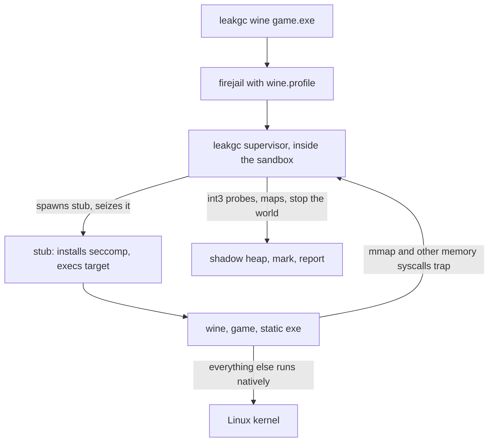

# leakgc: architecture plan (v2, proposal)

Status: **PROPOSAL, nothing implemented in the product yet.** P0-b spikes are done (section 7a). Open decisions are in section 9. P1 does not start until they are answered.
Supersedes the architecture sections of `HANDOVER.md` (left untouched).
No push. Each phase is its own commit, gated by `cargo xtask lint` and `cargo xtask coverage`.
Spikes live in `spikes/` (git-excluded, throwaway, not covered by the gate).

## 1. What changed from HANDOVER.md (and from v1)

| Area | Old (HANDOVER) | v2 (this plan) |
|---|---|---|
| Interposition | LD_PRELOAD / libc malloc | Dropped. Works for static binaries and for allocators that bypass the dynamic linker. |
| Launcher role | Spawns child | Process supervisor. Owns the child tree's memory syscalls and allocator entry points, and passes everything else through to the kernel. |
| Where the supervisor runs | Not considered | **Inside the Wine sandbox** when Wine is firejail-wrapped (D15). Verified: an outside supervisor cannot trace a firejail sandbox. |
| Object boundaries | Manual `alloc` calls | Observed from allocator entry points (malloc family), per family. |
| Roots | Manual `add_root` | Conservative: registers, stacks, writable memory (Boehm / Valgrind "still reachable" style). |
| Default behaviour | Auto-free | Report-only. Freeing is opt-in and needs a safe point. |
| Rust | Safe launcher | `#![forbid(unsafe_code)]` in all our crates. Verified in the spike. Dependencies do contain unsafe (section 8, R7). |
| Process lifecycle | Not considered | Supervisor drains every tracee before exiting, and always resumes or kills the stub on error (4.4). Learned from spike failures. |

Honest scope note: "like a VM" here means the supervisor owns the child's memory syscalls and allocator entry points, and reports on them. It is **not** a hardware VM and it is **not** an emulator. The child runs on the real Linux kernel, with the real GPU, at near-native speed. If you need literal VM semantics, that is option E1 (D17).

## 2. Research findings (verified vs. not verified)

- **Cosmopolitan Libc** (ISC): **verified, and the answer is no.** Its README and its strace implementation (`--strace` / `--ftrace`, in `libc/intrin/strace*` and the `sys_*` wrappers) only log calls made by Cosmopolitan's own runtime. It does not intercept syscalls from foreign code, so it cannot be used for Wine, games, or prebuilt binaries. Its APE format runs natively on several OSes, which is a different feature. I know you expected it to be the mechanism. It is not.
- **Blink** (`jart/blink`, ISC): **verified from its README.** A user-mode x86-64 interpreter. It runs static and dynamic Linux ELF. Every `SYSCALL` goes through the emulator (`-s` logs them). It is the only existing "VM that sees every instruction and memory access". Costs: no GPU, Linux 4.5 personality, 500+ instructions and 150+ syscalls implemented, C, and no hook for allocation boundaries (it would need a patched fork). See D17.
- **Wine's `ntdll.dll`** exports `RtlAllocateHeap`, `RtlFreeHeap`, `RtlReAllocateHeap`, `RtlSizeHeap` (checked earlier with `x86_64-w64-mingw32-objdump -p`). The Win32 heap can be identified by name. Hooking it is D1.
- **relibc** (MIT, Rust): **verified in P0-b.** It builds as a static libc. The malloc family is exported unprefixed and survives into the static binary. It is a test target only (D13). It pins `nightly-2026-05-24`.
- **Installed allocators (verified on this machine, symbols checked with `nm -D --defined-only`).** gperftools 2.18.1 (four tcmalloc variants, same exports), oneTBB 2.19 (`libtbbmalloc` exports `scalable_*` only, `libtbbmalloc_proxy` overrides the malloc family), jemalloc 5.4.0, mimalloc 3.5 (`mi_*` plus malloc overrides), musl 1.2.6 (`/usr/lib/musl/lib/libc.so`), Boehm `gc` 8.2.12 (`GC_malloc`, does not override malloc), and LLVM compiler-rt 23 with Scudo standalone (overrides malloc) and LeakSanitizer (`.a` only). `talloc` (Samba's pool library) and `libionic` (owned by `rdma-core`) are not allocator families and are excluded.
- **Valgrind** is still the ground truth. memcheck reports 64 bytes definitely lost on the dynamic build of a test program, and "no leaks are possible" on the static build of the same program. That silent miss is the failure mode this design must never repeat.
- **Environment (verified):** Linux, `ptrace_scope=1`. LSMs active: `capability, landlock, lockdown, yama, bpf` (no AppArmor). firejail 0.9.80 is what `/usr/local/bin/wine` is (a symlink). It picks `/etc/firejail/wine.profile` by program name. That profile sets `allow-debuggers`, `noroot`, `nonewprivs`, `caps.drop all`, `seccomp`, `restrict-namespaces`.

## 3. Execution engine options

| Option | Static binaries | Allocator-agnostic | Sees every memory access | GPU works | Speed | Notes |
|---|---|---|---|---|---|---|
| **E1** Emulator (Blink-style) | yes | yes, with adapters | yes | no | roughly 10x or worse | The only literal "VM". Good oracle for hard cases. C dependency. |
| **E2** Supervisor (seccomp TRACE + ptrace + int3 probes) | yes | yes, with adapters | at memory syscalls and probes only | yes | near native (about 27 µs per trap, see 7a) | Recommended. Verified end to end. Not a VM, and I want to be clear about that. |
| **E3** Hardware VM (KVM guest with Linux and Wine) | yes | yes, with adapters | yes (EPT / introspection) | no (unless passthrough) | near native CPU | Heavy: needs a guest image. Hard GPU story. |
| **E4** Rust monitor, native execution, allocation hooks and memory-syscall trap, no instruction interpretation (the Blink-style variant you asked for) | yes | yes, for identified allocators, same limits as E2 | at allocator entry points and memory syscalls only | yes | near native, plus hook cost (to be measured) | Chosen by the user (D17). Mechanism not yet proven, see P0-c. |

**Status (D17): E4 chosen by the user.** E2 remains the fallback if the E4 mechanism fails its spike (P0-c).

## 4. Recommended architecture (E2)

If Wine is not sandboxed, the `firejail` box is simply removed. The supervisor then runs at the top level.

### 4.1 Components

1. **Stub and launch (verified).** The supervisor spawns `leakgc __stub <target> [args]`. The stub builds the seccomp filter (all CStrings and argv are built before the filter is installed), calls `apply_filter`, raises `SIGSTOP`, and then `execv`s the target. The supervisor waits for the stub's group-stop (polling `/proc/<pid>/stat` for state `T`), then calls `PTRACE_SEIZE` with `TRACESECCOMP | TRACEEXEC | TRACECLONE | TRACEFORK | TRACEVFORK | EXITKILL`, and then `SIGCONT`. We do **not** use `PTRACE_TRACEME` (it would have the tracer be the child, and it makes the exec-trace logic harder). Filters survive `execve`.
2. **Syscall filter.** The spike traps `mmap` only, using `SECCOMP_RET_TRACE`. The P2 plan is to add `munmap`, `mremap`, `mprotect`, `madvise`, `brk`, `clone`, `clone3`, and `execve`. Each addition is measured in P2 against the cost in 7a. Everything not on the list runs natively at full speed.
3. **Memory map.** `/proc/<pid>/maps` gives the writable regions (the spike reads it and counts `rw` mappings). File-backed `MAP_SHARED`, device (`/dev/dri`, `/dev/nvidia*`) and SysV shm mappings are excluded from the heap and from scanning (R3).
4. **Probes.** On each process with a recognised allocator, `int3` is written through `/proc/<pid>/mem` at the entry of each family function (malloc, free, calloc, realloc, memalign, usable-size). The probe records the call. The return address gets a second probe to capture the return value. Each thread keeps an in-allocator depth counter (4.3). Probe rules from P0-b: dedupe re-entries by (rsp, return address). Glibc's `free` tail-jumps to its own entry, so entry-only probes over-count. Arm probes at exec-stop (static) or when the library's executable mapping appears (dynamic), not at program entry, or pre-main allocations are missed.
5. **Shadow heap.** Built only from observed calls: `(family, address, usable_size, thread)`. An interval map, so interior pointers resolve to the containing block. It does not read allocator internals. This is what makes the design allocator-agnostic.
6. **Stop the world.** `PTRACE_INTERRUPT` (or `SIGSTOP`) on every thread, then `PTRACE_GETREGS`.
7. **Roots and mark.** Conservative roots: all registers of all threads, all thread stacks, all other writable mappings, excluding known-free blocks. Every word inside a live block's `[start, start+usable)` marks it (interior pointers count). Iterative tri-color worklist, as in the OCaml prototype.
8. **Sweep.** Unmarked live blocks are candidates. Report mode prints a Valgrind-style summary grouped by call site (the site is the probe's return address, symbolised when possible). Free mode calls the family's `free` inside the child at a safe point (4.3).
9. **Allocator adapters.** A family is a table of symbol names plus a usable-size function. Discovery reads `.dynsym` and `.symtab` of every loaded ELF object. Stripped static binaries have no names, so they are detected but not supported until a signature mode exists (later phase). A recognised family whose entry points cannot be resolved is **fail-closed**: its blocks are never freed.

### 4.2 Why this shape

- Works for static binaries, because it observes the process directly and does not depend on the dynamic linker.
- Works for Wine and for the Rust port, because it sits below both, at the allocator and syscall boundary. Wine is an argument, not a dependency.
- Keeps our code safe. Ptrace, seccomp and `/proc` are reached through crates (`nix`, `seccompiler`). Our code contains no `unsafe` (verified). The crates do contain unsafe (R7).

### 4.3 Safe point and free injection

A block may only be freed when:

1. Its family is supported, and its entry points resolved.
2. It is unmarked after a full scan (no word in any root points into it, interior pointers included).
3. **Every thread has in-allocator depth 0.** Probes tell us when a thread is inside malloc/free, because we saw it enter and have not yet seen it leave. If any thread is busy, the collection is skipped and retried.
4. The freeing happens by injecting a call to the family's `free` into one stopped thread: save registers, set up a scratch return address on a page we own, call, restore. This is the gdb "inferior call" technique.

Residual risk: a thread can hold an allocator lock inside a function we did not probe. See R1.

### 4.4 Process lifecycle rules (learned from the P0-b spike)

These are requirements, not suggestions. Each one came from a failure we actually hit.

1. **Drain before exit.** Keep servicing ptrace events until `waitpid` returns `ECHILD`, even after the root has exited. Wine leaves `wineserver` running. If the supervisor returns early, its tracees either get `ENOMEM` from `ld.so` (no `EXITKILL`, the trap has no tracer and returns an error) or are killed by `EXITKILL`, which made the whole sandbox report exit 137 on a successful run.
2. **Never leave a stub stopped.** If the supervisor fails after the stub self-stops, the stub stays in group-stop forever. In the spike this hung the firejail monitor waiting on it. Every error path must `SIGCONT` the stub, or `SIGKILL` it. This is a `Drop` guard in P2.
3. **Exit code.** The root's exit code (or `128+sig`) is the exit code of `leakgc`, and it is reported only after the drain completes.
4. **Fail-closed on supervisor death.** `EXITKILL` ensures the traced tree dies with the supervisor. Without a tracer, a trapped `mmap` returns `ENOSYS`, so the program sees an allocation failure rather than silently running untracked. This is the mmap trap window: keep the code between `apply_filter` and the stop free of allocation (verified: the window is only the `raise`).

### 4.5 Wrapper placement (D15)

The real `wine` is a firejail sandbox, and that changes where the supervisor has to run.

- A supervisor **outside** the sandbox cannot seize a process inside it. Verified: `PTRACE_SEIZE` returns EPERM, with yama descendant checks satisfied. Strong inference (not proven in kernel source): firejail puts the sandbox in a child user namespace (`uid_map` is `1001 1001 1`), and Linux refuses a cross-namespace ptrace unless the tracer has `CAP_SYS_PTRACE` in the child's namespace. `strace` fails the same way.
- A stub that installs seccomp **and then** runs firejail fails. `seccompiler` sets `NO_NEW_PRIVS`, and firejail's setuid exec then fails with a lockfile error (verified earlier).
- A supervisor **inside** the sandbox works. Verified: the spike, run inside `firejail --profile=/etc/firejail/wine.profile`, seizes its own stub and runs real Wine (hello and `cmd`) to exit 0, with output intact.
- A plain firejail (no profile) blocks `ptrace` with EPERM in its default seccomp filter. `wine.profile` allows it with `allow-debuggers`. The profile must keep that line.

So the launch becomes: `leakgc wine game.exe` → (configured wrapper) `firejail --profile=/etc/firejail/wine.profile leakgc __supervise wine game.exe`. The wrapper is configuration (D15), and `leakgc` must know it.

## 5. Roots and what counts as "reachable"

- Reachable = marked by a conservative scan. A word that merely looks like a pointer keeps a block alive. This is the **safe** direction: false retention means a leak goes unreported. A false free means a crash, so we never take that risk silently.
- **Unknown allocators** (a region of writable memory that no family owns) are treated as roots. Blocks they point to are reported as "still reachable", not "definitely lost". Nothing inside an unknown region is ever freed.
- Report categories follow Valgrind: definitely lost, indirectly lost, possibly lost, still reachable, and "not covered" (bytes under an unsupported allocator).

## 6. Allocator coverage plan

| Family | Entry points | Test link modes |
|---|---|---|
| glibc | `malloc`, `free`, `calloc`, `realloc`, `memalign`, `posix_memalign`, `aligned_alloc`, `malloc_usable_size`, plus `__libc_*` variants | dynamic, static (with symbols), static stripped |
| mimalloc (installed, v3.5.4) | `mi_malloc`, `mi_free`, `mi_realloc`, `mi_calloc`, `mi_usable_size`, plus unprefixed overrides in `libmimalloc.so.3` | dynamic (`/usr/lib/libmimalloc.so.3`), static (source build, see 7a) |
| jemalloc (installed) | unprefixed `malloc` family, `malloc_usable_size`, `mallctl` (not used for tracking) | dynamic, static |
| gperftools tcmalloc 2.18.1 (installed): `libtcmalloc.so.4.6.5`, `libtcmalloc_minimal.so.4.6.5`, `libtcmalloc_debug.so.4.6.5`, `libtcmalloc_and_profiler.so.4.7.5` | `malloc` family (unprefixed), `tc_malloc`, `tc_malloc_size` for usable size. All four export the same set. | dynamic, one test row per variant (each is a separate build, so each is tested) |
| oneTBB tbbmalloc 2.19 (installed): `libtbbmalloc.so.2.19` | `scalable_malloc`, `scalable_calloc`, `scalable_realloc`, `scalable_free`, `scalable_posix_memalign`, `scalable_msize` for usable size. Not a malloc override. | dynamic, linked directly |
| oneTBB malloc proxy (installed): `libtbbmalloc_proxy.so.2.19` | `malloc` family (unprefixed), as a malloc override | dynamic, preloaded by the test program |
| Scudo standalone (LLVM compiler-rt 23, installed): `libclang_rt.scudo_standalone-x86_64.so` | `malloc` family (unprefixed), `malloc_usable_size` | dynamic. Static `.a` exists but is not verified. Hardened, so a good stress target. |
| Boehm GC `gc` 8.2.12 (installed): `libgc.so.1.5.6` | `GC_malloc`, `GC_free`, `GC_init`. Does not override malloc. | **Covered, report-only (D19).** Boehm frees its own unreachable memory, so leakgc never frees its blocks. Reports for Boehm-managed blocks are labelled as such. |
| LeakSanitizer (LLVM compiler-rt 23, installed): `libclang_rt.lsan-x86_64.a` | Not an allocator. Exit-time leak checker. | **Oracle only**, for ASan-built test programs. It has the same blind spot as Valgrind for objects still reachable at exit. |
| musl 1.2.6 (installed, `/usr/lib/musl/lib/libc.so`) | `malloc`, `free`, `calloc`, `realloc`, `memalign`, `posix_memalign`, `aligned_alloc`, `malloc_usable_size` (verified with `nm -D`) | dynamic. Static not yet checked. |
| relibc (Rust libc, dlmalloc-rs) | `malloc`, `free`, `calloc`, `realloc`, `memalign` family from `libc.a` (verified in P0-b) | static only, built from source with the pinned nightly. **TEST ONLY (D13).** Never a production family. |
| Unknown / custom | none (fail-closed) | any; must show as "not covered" |

Test matrix: each allocator x each link mode x each test program. Each row is checked against Valgrind on the dynamic builds (ground truth). The static builds are checked against the leak count written into the test program, because Valgrind is blind there.

Note for static glibc: small allocations use `brk`, not `mmap`. A syscall-only view would see none of them. Object boundaries must come from entry-point probes (verified in P0-b for relibc, and the probe table in 7a for glibc and mimalloc).

## 7. Phases (each its own commit, no push)

- **P0-a (this document).** Done in v2. No LICENSE or acknowledgements, as requested.
- **P0-b: feasibility spikes (throwaway, not committed).** **Done.** Results in 7a. Spikes covered: stub and seccomp trace (safe Rust), int3 probes (glibc, mimalloc, relibc), `/proc/<pid>/maps`, firejail behaviour (both placements), Wine syscall rate.
- **P1: GC core in Rust.** Port of `ocaml/leakcheck.ml` semantics: interval map, tri-color mark, sweep, Valgrind-style report, over an abstract memory trait so tests need no OS. Differential tests against the OCaml oracle (same random operation traces, same results). 100% coverage gate.
- **P2: supervisor, observe only.** Stub, seccomp TRACE (trap set from 4.1), drain rules (4.4), process tree, memory map, `Drop` guard. Logs memory syscalls. Tests: static and dynamic hello-world, multi-threaded, fork, a leftover daemon, supervisor error injected after stub stop (must not hang). Runs inside the wrapper when one is configured (D15).
- **P3: allocator adapters and probes, report only.** Includes identification of stripped static binaries (D7), which needs its own spike before it is committed to. glibc first, then mimalloc, then jemalloc, tcmalloc and relibc. Test matrix from section 6. relibc is a compatibility check: its static test programs must report the same leak counts as the other static builds, and any mismatch is a finding to investigate, not a reason to skip it.
- **P4: conservative roots and report.** Stop the world, register and stack scanning, mark, Valgrind-style report. Known-leak test programs with expected output.
- **P5: free injection.** Safe-point logic, depth tracking, injected `free`, quarantine mode (delay frees by one cycle and poison the block, so a wrong free shows up as a clear failure rather than silent corruption). Opt-in `--free`.
- **P6: Wine integration.** Real Wine first (`/usr/lib/wine`, through the wrapper from D15). The Rust port when it is available. The Win32 heap is handled according to D1.
- **P7: CLI and config.** `--report` (default) / `--free`, wrapper configuration, time-based pacing (replaces `collect_every = 64`), verbosity, pid filter.
- **P8: LICENSE and ACKNOWLEDGEMENTS.** Written at the end, after the license is chosen (D12) and all third-party code is known.

Gate for every phase: `cargo xtask lint`, `cargo xtask coverage` (files, lines, regions, functions at 100% for `src/**`), and the phase's tests.

## 7a. P0-b results (verified, throwaway spikes in `spikes/`, excluded from git)

### Seccomp stub and tracing (`spikes/seccomp_spike`, safe Rust, `#![forbid(unsafe_code)]`)

| Run | Result |
|---|---|
| Direct, `glibc_dyn` | exit 0, 8 mmap stops, output unchanged (native and traced both silent) |
| Direct, `sh -c 'echo; exit 3'` (fork, exec, exit code) | output intact, exit 3, 36 stops, 3 tracees |
| Direct, `glibc_static` | exit 0, **0 mmap stops** (small allocations use `brk`, which is not trapped yet) |
| Direct, `mi_static` / `mi_dyn` | exit 0, 3 / 16 mmap stops |
| Direct, Wine hello, warm wineserver | exit 0, about 280 mmap stops, 3 tracees |
| Direct, Wine `cmd /c echo` | output intact, exit 0, **4562 stops**. Timed: 351 ms native vs 475 ms traced (debug build, about 27 µs per trap). |
| Outside supervisor, firejail (any profile) | `PTRACE_SEIZE` EPERM on the sandboxed stub (section 4.5) |
| Inside supervisor, plain firejail | EPERM from the firejail default seccomp, which blocks `ptrace` |
| **Inside supervisor, `wine.profile`, `glibc_dyn`** | exit 0, 8 stops, output intact |
| **Inside supervisor, `wine.profile`, Wine hello** (2 runs) | exit 0 both times, about 12.4k stops, 89 to 90 tracees. A fresh wineserver starts every run inside the sandbox, so this is a cold-start cost. |
| **Inside supervisor, `wine.profile`, Wine `cmd`** | output intact, exit 0, 15.3k stops |
| User's real `/usr/local/bin/wine`, no spike | exit 0 for hello and `cmd` (baseline) |

Lifecycle bugs the spike hit and the fixes (now rules in 4.4): an early-returning supervisor produced `ENOMEM` in a surviving daemon (no `EXITKILL`) or exit 137 (with `EXITKILL`). A panic after the stub self-stopped left it stopped, and firejail hung waiting on it. The fix was to keep draining until `ECHILD`.

Cost of the trap: about 27 µs per mmap stop in a debug build (measured on `cmd`). The release build is not measured yet. Wine cold start under the sandbox: about 12.4k traps, so about 0.33 s of trap overhead, before any allocation work.

### R7 audit (unsafe in dependencies, from the spike's `Cargo.lock`)

- Our code: 0 `unsafe` (`#![forbid(unsafe_code)]`).
- `libc` 0.2.189: FFI declarations and helpers, in many files.
- `nix` 0.31.2: syscall wrappers, in most files.
- `seccompiler` 0.5.0: 2 real `unsafe` blocks in `apply_filter` (`prctl(NO_NEW_PRIVS)` and the seccomp syscall). The rest are in its tests.
- `bitflags` 2.13.2: a few. `cfg-if`, `cfg_aliases`: none.

Counts are approximate (grep, which includes comments). "Rust must be safe" holds for our code. It does not hold transitively, because `nix` and `libc` are FFI layers by design. This is the decision in D3 and R7.

### Probes (glibc and mimalloc, from the earlier P0-b run, `spikes/probe3`)

| Binary | malloc | free | reentries | Notes |
|---|---|---|---|---|
| `glibc_static` | 9 | 3 | 1 | 6 mallocs are glibc startup |
| `glibc_dyn` + libc.so.6 | 3 | 1 | 1 | free tail-jumps to its own entry |
| `mi_dyn` + `/usr/lib/libmimalloc.so.3` | 3 | 1 | 0 | calls resolve to mi_malloc / mi_free |
| `mi_static` (mimalloc v3.5.4 source build, malloc override) | 9 | 3 | 0 | static startup mallocs go through mimalloc |

Mimalloc static: the installed `/usr/lib/libmimalloc.a` (LTO-slim) does not expose `mi_malloc` to the linker. The workable substitute is a source build: `cmake -DMI_OVERRIDE=ON -DMI_BUILD_SHARED=OFF -DMI_BUILD_STATIC=ON -DMI_BUILD_OBJECT=OFF -DMI_BUILD_TESTS=OFF` of v3.5.4. An `mi_static` built from the installed archive is byte-identical to `glibc_static`, so it silently tested the wrong allocator. Keep this in mind for the test matrix.

### relibc (test only, D13)

- Builds on the pinned `nightly-2026-05-24` with `-Z build-std`. Its Redox-only git dependencies resolved.
- Exports the malloc family unprefixed. The symbols survive into the final static binary, so name-based adapters work.
- The syscall view alone is not enough (three mallocs produced two mmaps). Object boundaries must come from entry-point probes.
- An int3 probe on relibc `malloc` and `free` reports 3 mallocs and 1 free with correct sizes, return values, and free argument.

### Lessons (now test-authoring rules)

- GCC deletes unused `malloc`/`free` pairs as built-ins. Test programs must use `-fno-builtin` and make the pointers escape, or the probe sees nothing.
- A probe that restores the wrong bytes silently corrupts code. The first version did this. Every probe test must assert the exact sequence of calls and arguments, not just that the child exits.
- Addresses shift on relink. Adapters resolve symbols at run time, not at fixed addresses.
- Empty rule vector in `seccompiler` means "match any arguments" (verified in the crate's docs and code).

## 8. Risks (stated plainly)

- **R1 Allocator lock held at a stop.** Freeing with a thread inside an allocator lock can deadlock or corrupt. Mitigation: depth tracking (4.3) and skipping busy collections. Residual risk remains, so free mode stays opt-in until P5 is validated on all families.
- **R2 Hidden pointers.** Pointers stored XORed, tagged, compressed or NaN-boxed are invisible to a conservative scan, so they cause false frees. Mitigation: quarantine (P5), report-only default, and the rule "free nothing you cannot see".
- **R3 Memory the scan does not see.** Pointers held only in the kernel (in-flight I/O, io_uring), in GPU or DMA buffers, or in shared memory. Freeing a block that DMA is writing into corrupts it. Mitigation: exclude device and shm mappings from frees, and report them as "not covered".
- **R4 Undercounted allocations.** A call path we did not probe means a live block is not in the shadow heap. Safe, because unknown regions are roots, but those blocks are never freed and the report must say so.
- **R5 Performance.** Every probed malloc is several ptrace stops. Every trapped mmap is about 27 µs (debug). Wine cold start inside the sandbox is about 12.4k traps. Steady state for a real game is still unmeasured. Measure in P3. A later option is trampolines in place of probes (binary patching, more complexity).
- **R6 Firejail.** Verified: the sandbox blocks outside tracing (4.5), and its default seccomp blocks `ptrace` unless `allow-debuggers` is set. Mitigation: the supervisor runs inside the sandbox, and the profile must keep `allow-debuggers`.
- **R7 "Rust must be safe" depends on dependencies.** Our code is unsafe-free (verified). `nix`, `libc`, and `seccompiler` contain unsafe internally (section 7a). Decide whether that is acceptable (D3). `cargo xtask audit` should fail if any of our crates lack `forbid(unsafe_code)`.
- **R8 "Any allocator" is limited to families we support.** An unknown allocator is reported as "not covered" and never freed. Fail-closed, not "works for everything".
- **R9 Linux only.** E2 depends on Linux ptrace and seccomp. Fine for Wine. It does not give the FreeBSD or bare-metal personality (D11).
- **R10 relibc is not a real-world allocator.** Its malloc is dlmalloc, which behaves differently from glibc, mimalloc and jemalloc under fragmentation and thread caches. A clean result says the probes and shadow heap work. It says nothing about Wine or games.
- **R11 Outside supervision of a sandbox is impossible (new).** Verified EPERM. Any design that supervises from outside a firejail-wrapped Wine fails. Mitigation: 4.5.
- **R12 Lingering daemons (new).** `wineserver` and similar processes outlive the root. Supervision must drain them (4.4 rule 1), or they are killed or left untraced. Verified in the spike.
- **R13 Supervisor error leaves a stopped stub (new).** Verified hang. Mitigation: `Drop` guard (4.4 rule 2).
- **R14 `brk` and `munmap` are not trapped yet (new).** The spike traps `mmap` only. Static glibc small allocations use `brk`, so their region growth is invisible to the trap. Mitigation: read `/proc/<pid>/maps` at each collection, and trap `brk` in P2 if measurements justify it.
- **R15 Cold start cost (new).** Each sandboxed Wine run starts a fresh wineserver, so the first seconds carry about 12.4k traps. Measure in P3 whether this matters for the user's workflow.

## 9. Decisions needed (nothing below is decided yet)

- **D1 Win32 heap (`RtlAllocateHeap` etc.).** Options: (a) hook the exports in `ntdll`. This instruments Wine, which contradicts the locked rule "never inside wine". (b) Leave it as "not covered" and report it. (c) An explicit opt-in adapter you enable. **Recommendation: (b)**, because it respects the locked rule. Game allocations made through HeapAlloc are then never freed.
- **D2 Engine.** E2 (recommended) or E1 (literal VM, see D17). Confirm E2. Please say explicitly if you wanted E1 or E3.
- **D3 GC core language.** The locked decision was OCaml. A Rust supervisor cannot call OCaml without `unsafe` FFI, which violates the Rust rule. Options: (a) keep OCaml as a separate process fed over a pipe (no unsafe, but a second runtime and latency); (b) port the core to Rust and keep OCaml as the executable spec and oracle. **Recommendation: (b)**, with OCaml as the reference for differential tests.
- **D4 Default mode.** Report-only by default, free only with `--free`. **Recommendation: yes.**
- **D5 Multi-threaded freeing.** Allow freeing in multi-threaded processes, or only report until P5 is validated? **Recommendation: report-only for multi-threaded processes until validated.**
- **D6 "Any allocator".** Interpreted as: any family with an adapter, and everything else is reported as not covered. **Recommendation: confirm.**
- **D7 Static binaries (DECIDED by the user): support all binaries, including stripped ones.** Stripped static binaries have no symbol names, so their allocator entry points must be found another way (for example, byte signatures of known allocator builds, or the entry-point probes from P3 combined with a code scan). This is the hardest part of P3 and is not proven yet. Known limit: no method can guarantee that every unknown allocator is found. The fail-closed rule stays as the fallback. Anything that cannot be identified is reported as "not covered" and is never freed, and the report says so explicitly.
- **D8 Uncovered memory.** Warn in the report and never free it. **Recommendation: confirm.**
- **D9 Allocator-agnostic region tracking.** Use all writable memory as conservative roots (recommended). Do not use it for object boundaries. **Recommendation: confirm.**
- **D10 Process scope.** Which processes in the tree are managed? All, only those with a supported family, or a `--pid` filter. Wineserver should probably be excluded from freeing, but still drained (4.4). **Recommendation: only processes with a supported family, and always drain.**
- **D11 Personality.** The child sees the real Linux kernel (transparent). FreeBSD or bare-metal personalities would be a separate, much larger project (closer to E1). Confirm that transparent Linux is enough.
- **D12 Project license.** Needed for `LICENSE` and `ACKNOWLEDGEMENTS`. Blink and Cosmopolitan (both ISC) need attribution only if their code or design is reused. Valgrind is GPL, so we take the idea and never its code, which keeps the project MIT-clean. **DECIDED: MIT** (chosen by the user). The `LICENSE` file and `ACKNOWLEDGEMENTS` are written in P8, after the remaining decisions are closed.
- **D13 relibc scope. DECIDED: test target only.**
- **D14 Toolchain for relibc. APPROVED** and used in P0-b (`nightly-2026-05-24`, `rust-src`). Scratch work stays outside the repo.
- **D15 Where the supervisor runs when Wine is sandboxed (new, verified).** Options: (a) **leakgc runs inside the same firejail profile** as the payload: `firejail --profile=/etc/firejail/wine.profile leakgc __supervise wine game.exe`. Verified end to end. Needs `allow-debuggers` (already in `wine.profile`) and a config entry naming the wrapper. (b) Drop the sandbox and supervise bare Wine. Verified to work, but it loses the isolation the user already has. (c) Keep an outside supervisor. Verified impossible (EPERM). **DECIDED: (a), with `/etc/firejail/wine.profile`.**
- **D16 Seccomp or pure ptrace (new).** Keep seccomp TRACE for memory syscalls (verified, gives exact region lifetimes at about 27 µs per trap), or drop it and poll `/proc/<pid>/maps` at each collection (no per-mmap cost, but new libraries and regions are found late, and `munmap` is invisible). **Recommendation: keep seccomp for P2**, then decide with P2 measurements on real games. Both need the int3 probes anyway.
- **D17 Engine (DECIDED by the user): E4.** A Blink-style monitor written in Rust that does not interpret instructions. The guest runs natively, and the monitor intercepts only memory allocation: allocator entry points, plus memory syscalls such as `mmap`, `munmap` and `brk`. Effects: the GPU works and the speed is near native. It is not a VM in Blink's sense, because instructions are not emulated, so a memory access that bypasses the hooked entry points is invisible. Open risks, to be settled by a spike (P0-c) before P1 or P2 depends on it: (1) how hooks are injected, either in-process at exec-stop or from outside with ptrace; (2) how the monitor avoids racing the guest while it patches code; (3) whether decoding instruction lengths at hook sites counts as instruction interpretation (it decodes lengths only, and does not execute anything). E2 is the fallback if the spike fails. The identification problem for stripped and custom-allocator binaries (D7, D21) is unchanged.
- **D18 Trap set and cost budget (new).** The P2 trap list (section 4.1, item 2) includes `brk`, `munmap`, `mprotect` and `clone*`. Each adds stops. **Recommendation: start with `mmap`, `munmap`, `mremap`, `brk`, `clone`, `clone3`, and `execve`, and measure in P2 on a real game before adding more.**
- **D19 Boehm `libgc` (DECIDED, amended after D21): covered in report-only mode.** leakgc observes the `GC_malloc` family and reports leaks like any other family, but never frees a Boehm block. Reason: Boehm already reclaims unreachable memory itself, so freeing its blocks would conflict with its collector. Caveat: leakgc's roots can differ from Boehm's (for example, roots registered with `GC_add_roots`), so a block that Boehm keeps alive may be reported as leaked. Such reports must be labelled as Boehm-managed, not as definitely lost.
- **D21 Rust custom global allocators (DECIDED by the user): covered.** Any binary is in scope, including Rust programs with a custom `#[global_allocator]` that never calls `malloc`, the same rule as D7. Consequence: to report leaks for such an allocator, its allocation and free entry points must be identified in the binary, which is the D7 identification problem. Region-level tracking (`mmap`, `brk`, `/proc/<pid>/maps`) alone cannot report leaks. This sits badly with the "like a VM" wording, so D17 (E1 emulator or E2 supervisor) must be settled before P3. D17 is still open.
- **D20 Allocator families in scope (DECIDED).** Support glibc, mimalloc, jemalloc, gperftools tcmalloc (4 variants), oneTBB tbbmalloc (including its malloc proxy), Scudo standalone and musl. relibc is test only (D13). Boehm is detect-and-refuse (D19). LeakSanitizer is oracle only. Priority order for P3: glibc, then mimalloc, then the rest. Caveat: most Windows game memory goes through Wine's heap, which is "not covered" under D1, so these families mainly cover Wine internals and native Linux code.

## 10. Acknowledgements (to be finalised in P8)

Pending, and tied to D12. Candidates: Valgrind (leak-kind taxonomy, the idea), relibc (MIT, if its code or build is used), Blink and Cosmopolitan Libc (ISC, if code or design is reused), Boehm-Demers-Weiser conservative GC (conservative-root model), the OCaml runtime (tri-color marking reference), and the authors of `nix`, `libc`, `seccompiler` and any other crate we depend on.
