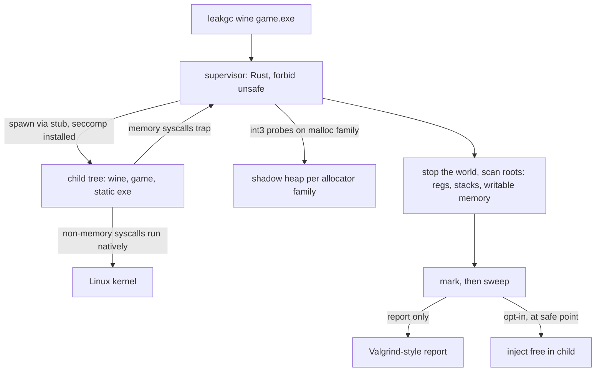

# leakgc: architecture plan (v1, proposal)

Status: **PROPOSAL, nothing implemented.** Open decisions are in section 9 and must be answered before phase P2.
Supersedes the architecture sections of `HANDOVER.md` (that file is left untouched for now).
No push. Each phase is its own commit, gated by `cargo xtask lint` and `cargo xtask coverage`.

## 1. What changes from HANDOVER.md

| Area | Old (HANDOVER) | New (this plan) |
|---|---|---|
| Interposition | LD_PRELOAD / libc malloc | Dropped. Cannot see static binaries or allocators that do not go through the dynamic linker. |
| Launcher role | Spawns child | Process supervisor: owns the child's memory syscalls and allocator entry points, passes all other syscalls through to the real kernel. |
| Object boundaries | Manual `alloc` calls | Observed from the allocator's own entry points (malloc/free family), recorded per family. |
| Roots | Manual `add_root` | Conservative: registers, stacks, writable memory (Boehm / Valgrind "still reachable" style). |
| Default behaviour | Auto-free | Report-only. Freeing is opt-in and needs a safe point. |
| Rust | Safe launcher | `#![forbid(unsafe_code)]` in all our crates. Dependencies may contain unsafe; we do not write it. |

Honest scope note: "like a VM" here means the supervisor owns the child's address space and memory syscalls. It is **not** a hardware VM. The child still runs on the real Linux kernel, with the real GPU, at near-native speed.

## 2. Research findings (verified vs. not verified)

- **Cosmopolitan Libc** (ISC): its README says `--strace` and `--ftrace` log calls made through its own runtime. It does not intercept syscalls from foreign code, so it cannot help with Wine, games, or prebuilt binaries. **Not verified:** I read the README only, not the source. If you meant a specific Cosmopolitan source file, point me to it and I will check it.
- **Blink** (`jart/blink`, ISC): an x86-64 user-mode emulator. It runs static and dynamic Linux ELF, sees every `SYSCALL` and every memory access, and logs syscalls with `-s`. It is the closest existing "VM that sees everything, static binaries included". Costs: no GPU passthrough, and the README says `-j` (no JIT) is about 10x slower. It is C, which matters for the Rust-only rule. ISC requires attribution, so it would appear in `ACKNOWLEDGEMENTS`.
- **Wine's `ntdll.dll`** is present at `/usr/lib/wine/x86_64-windows/ntdll.dll`. Its export table contains `RtlAllocateHeap`, `RtlFreeHeap`, `RtlReAllocateHeap` and `RtlSizeHeap` (checked with `x86_64-w64-mingw32-objdump -p`). The Win32 heap can therefore be identified by name. Hooking it is a separate decision (D1).
- **relibc** (MIT, Redox OS, Rust): a libc written in Rust, built as a `staticlib`. Its malloc is a vendored `dlmalloc-rs` exposed through its `c_api` feature. The Linux path uses raw syscalls via the `sc` crate and is mainly exercised by its own test suite (`./check.sh --test --host` runs statically linked tests). It is **not** a glibc replacement and Wine will not run on it, so it is a compatibility target for static binaries and a malloc test case, not a production family. It pins `nightly-2026-05-24` in `rust-toolchain.toml`, which we do not have installed. **Not verified:** whether `libc.a` keeps its symbols (`.symtab`) after the build, which decides whether our adapter can find `malloc` without signatures.
- **Valgrind** is still useful as ground truth. Verified earlier: memcheck reports 64 bytes definitely lost on the dynamic build of a test program, and reports "no leaks are possible" on the static build of the same program. That silent miss is the failure mode this design must never repeat.
- **Environment:** `ptrace_scope=1` (a parent can trace its own children, which is what the supervisor is). Firejail wraps `wine` (`/usr/local/bin/wine` to `/usr/bin/firejail`). Its seccomp list in the child has not been checked yet (see R6).

## 3. Execution engine options

| Option | Static binaries | Allocator-agnostic | Sees every memory access | GPU works | Speed | Notes |
|---|---|---|---|---|---|---|
| **E1** Emulator (Blink-style) | yes | yes, with adapters | yes | no | roughly 10x or worse | Highest coverage. Good oracle for debugging. Probably C. |
| **E2** Process supervisor (seccomp TRACE + ptrace + int3 probes) | yes | yes, with adapters | only at syscalls and probes | yes | near native | Recommended. Pass-through for everything not memory-related. Linux only. |
| **E3** Hardware VM (KVM guest with Linux and Wine) | yes | yes, with adapters | yes (EPT / introspection) | no (unless passthrough) | near native CPU | Heavy: needs a guest image. Harder to integrate with the host GPU. |

**Recommendation: E2** as the product. E1 can come later as an oracle for checking E2 on hard cases.

## 4. Recommended architecture (E2)

### 4.1 Components

1. **Stub + launch.** `leakgc` re-executes itself as `leakgc __exec <cmd>`. The stub installs a seccomp filter, then `exec`s the real command. Filters persist across `execve`. The supervisor is the tracer (`PTRACE_TRACEME` in the stub, or `PTRACE_SEIZE`). This avoids `pre_exec`, which is unsafe in std.
2. **Syscall filter.** `SECCOMP_RET_TRACE` only for: `mmap`, `munmap`, `mremap`, `brk`, `madvise`, `mprotect`, `clone`, `clone3`, `fork`, `vfork`, `execve`, `exit_group`. Everything else runs natively at full speed. Trace options: `TRACECLONE | TRACEFORK | TRACEVFORK | TRACEEXEC`, so the whole process tree is followed (wine, wineserver, game).
3. **Memory map.** `/proc/<pid>/maps` gives the writable regions. Those that are file-backed `MAP_SHARED`, device (`/dev/dri`, `/dev/nvidia*`), or SysV shm are excluded from the heap and from scanning (see R3).
4. **Probes.** On each process that has a recognised allocator, `int3` is written through `/proc/<pid>/mem` at the entry of each family function (malloc, free, calloc, realloc, memalign, usable-size). The probe records the call. The return address gets a second probe to capture the return value. Each thread keeps an in-allocator depth counter (see 4.3).
5. **Shadow heap.** Built only from observed calls: `(family, address, usable_size, thread)`. It is an interval map, so interior pointers resolve to the containing block. It does not read allocator internals. This is what makes the design allocator-agnostic.
6. **Stop the world.** `PTRACE_INTERRUPT` (or `SIGSTOP`) on every thread. Read registers with `PTRACE_GETREGS`.
7. **Roots and mark.** Conservative roots: all registers of all threads, all thread stacks, all other writable mappings, excluding known-free blocks. Every word that falls inside a live block's `[start, start+usable)` marks that block (interior pointers count). Iterative tri-color worklist, as in the OCaml prototype.
8. **Sweep.** Unmarked live blocks are candidates. Report mode prints a Valgrind-style summary grouped by call site (the site comes from the probe's return address, symbolised when possible). Free mode calls the family's `free` inside the child at a safe point (4.3).
9. **Allocator adapters.** A family is a table of symbol names plus a usable-size function. Discovery reads `.dynsym` and `.symtab` of every loaded ELF object. Stripped static binaries have no names, so they are detected but not supported until a signature mode exists (later phase). A recognised family whose entry points cannot be resolved is **fail-closed**: its blocks are not freed.

### 4.2 Why this shape

- Works for static binaries, because it observes the process directly and does not depend on the dynamic linker.
- Works for Wine and for the Rust port, because it sits below both, at the allocator and syscall boundary. Wine is an argument, not a dependency.
- Keeps the Rust code safe. Ptrace, seccomp and `/proc/<pid>/mem` are reachable through safe crates (`nix`, a seccomp crate). Our own code contains no `unsafe`. Whether each crate is actually unsafe-free internally is **to be verified in P0-b** (R7).

### 4.3 Safe point and free injection

A block may only be freed when:

1. Its family is supported, and its entry points resolved.
2. It is unmarked after a full scan (no word in any root points into it, interior pointers included).
3. **Every thread has in-allocator depth 0.** Our probes know when a thread is inside a malloc/free call, because we saw it enter and have not yet seen it leave. If any thread is busy, the collection is skipped and retried later.
4. The freeing happens by injecting a call to the family's `free` into one stopped thread: save registers, set up a scratch return address on a page we own, call, restore. This is the gdb "inferior call" technique.

Residual risk: a thread can hold an allocator lock inside a function we did not probe. Every probed entry point (public and internal `__libc_*` names) reduces this risk, but does not remove it. See R1.

## 5. Roots and what counts as "reachable"

- Reachable = marked by a conservative scan. A word that merely looks like a pointer keeps a block alive. This is the **safe** direction: false retention means a leak goes unreported. A false free means a crash, so we never take that risk silently.
- **Unknown allocators** (a region of writable memory that no family owns) are treated as roots. Blocks they point to are reported as "still reachable", not "definitely lost". Nothing inside an unknown region is ever freed.
- Report categories follow Valgrind: definitely lost, indirectly lost, possibly lost, still reachable, and "not covered" (bytes under an unsupported allocator).

## 6. Allocator coverage plan

| Family | Entry points | Test link modes |
|---|---|---|
| glibc | `malloc`, `free`, `calloc`, `realloc`, `memalign`, `posix_memalign`, `aligned_alloc`, `malloc_usable_size`, plus `__libc_*` variants | dynamic, static (with symbols), static stripped |
| mimalloc (installed, v3.5.4) | `mi_malloc`, `mi_free`, `mi_realloc`, `mi_calloc`, `mi_usable_size`, plus unprefixed overrides in `libmimalloc.so.3` | dynamic, static (`libmimalloc.a`), static stripped |
| jemalloc (installed) | unprefixed `malloc` family, `malloc_usable_size`, `mallctl` (not used for tracking) | dynamic, static |
| tcmalloc (installed) | `malloc` family, `tc_*` (`tc_malloc_size` for usable size) | dynamic |
| musl | `malloc` family | only if it is installed; otherwise skipped |
| relibc (Rust libc, dlmalloc-rs) | `malloc`, `free`, `calloc`, `realloc`, `memalign` family from `libc.a` (confirmed in P0-b) | static only; built from source with the pinned nightly. **TEST ONLY (D13).** Never a production family. |
| Unknown / custom | none (fail-closed) | any; must show as "not covered" |

Test matrix: each allocator x each link mode x each test program. Each row is checked against Valgrind on the dynamic builds (ground truth). The static builds are checked against the expected leak count written into the test program, because Valgrind is blind there.

## 7. Phases (each its own commit, no push)

- **P0-a (this document).** Commit `PLAN.md` after the decisions in section 9 are answered. No LICENSE or acknowledgements yet, as requested.
- **P0-b: feasibility spikes (throwaway, not committed).** Verify, on this machine: (1) a Rust stub can install seccomp and be traced, using only safe crates; (2) int3 probes on mimalloc and glibc fire and return correctly; (3) read the child's writable maps; (4) firejail's seccomp list does not block the tracer's own operations; (5) how many syscalls a Wine process makes per second, to size the trace filter cost.
- **P1: GC core in Rust.** Port of `ocaml/leakcheck.ml` semantics: interval map, tri-color mark, sweep, Valgrind-style report, over an abstract memory trait so tests need no OS. Differential tests against the OCaml oracle (same random operation traces, same results). 100% coverage gate.
- **P2: supervisor, observe only.** Stub, seccomp TRACE, process tree, memory map. Logs memory syscalls. Tests: static and dynamic hello-world, multi-threaded, fork.
- **P3: allocator adapters and probes, report only.** glibc first, then mimalloc, then jemalloc, tcmalloc and relibc. Test matrix from section 6. relibc is a compatibility check: its static test programs must report the same leak counts as the other static builds, and any mismatch is a finding to investigate, not a reason to skip it.
- **P4: conservative roots and report.** Stop the world, register and stack scanning, mark, Valgrind-style report. Known-leak test programs with expected output.
- **P5: free injection.** Safe-point logic, depth tracking, injected `free`, quarantine mode (delay frees by one cycle and poison the block, so a wrong free shows up as a clear failure rather than silent corruption). Opt-in `--free`.
- **P6: Wine integration.** Real Wine first (`/usr/lib/wine`). The Rust port when it is available. The Win32 heap is handled according to D1.
- **P7: CLI and config.** `--report` (default) / `--free`, time-based pacing (replaces `collect_every = 64`), verbosity, pid filter.
- **P8: LICENSE and ACKNOWLEDGEMENTS.** Written at the end, after the license is chosen (D12) and all third-party code is known.

Gate for every phase: `cargo xtask lint`, `cargo xtask coverage` (files, lines, regions, functions at 100% for `src/**`), and the phase's tests.

## 7a. P0-b results so far (throwaway spikes in `spikes/`, excluded from git)

Relibc (test target only, D13):

- Builds on the pinned `nightly-2026-05-24` with `-Z build-std`. Its Redox-only git dependencies (`gitlab.redox-os.org`) also resolved here.
- `librelibc.a` exports the malloc family unprefixed (`malloc`, `free`, `calloc`, `realloc`, `memalign`, `posix_memalign`, `aligned_alloc`, `malloc_usable_size`). The symbols survive into the final static binary, so name-based adapters work for it.
- Syscall view alone is not enough. Three `malloc` calls produced only two `mmap` calls, so the syscall layer sees regions, not objects. Object boundaries must come from entry-point probes.
- An `int3` probe on relibc's `malloc` and `free` works: 3 mallocs and 1 free are reported with correct sizes, return values, and free argument, and the child exits 0.

Lessons from the spike (now test-authoring rules):

- GCC deletes unused `malloc`/`free` pairs as built-ins. Test programs must use `-fno-builtin` and make the pointers escape, or the probe sees nothing.
- A probe that restores the wrong bytes silently corrupts code. The spike's first version did this, and only the wrong argument values revealed it. Every probe test must assert the exact sequence of calls and arguments, not just that the child exits.
- Addresses shift on relink. Adapters must resolve symbols at run time, not hard-code them.

Not done yet in P0-b: glibc and mimalloc probes, the seccomp stub (safe Rust only), `/proc/<pid>/maps` reading, the firejail check, and syscall-rate measurement under Wine.

## 8. Risks (stated plainly)

- **R1 Allocator lock held at a stop.** Freeing with a thread inside an allocator lock can deadlock or corrupt. Mitigation: depth tracking (4.3) plus skipping busy collections. Residual risk remains, and free mode stays opt-in until P5 is validated on all families.
- **R2 Hidden pointers.** Pointers stored XORed, tagged, compressed or in NaN-boxed form are invisible to a conservative scan. The result is a false free. Mitigation: quarantine mode (P5), report-only default, and the rule "free nothing you cannot see".
- **R3 Memory the scan does not see.** Pointers held only inside the kernel (in-flight I/O, io_uring), in GPU or DMA buffers, or in shared memory. Freeing a block that DMA is writing into corrupts it. Mitigation: exclude device and shm mappings from frees, and report them as "not covered".
- **R4 Undercounted allocations.** A call path we did not probe (for example an internal allocator call inside a library) means a live block is not in the shadow heap. Safe, because unknown regions are roots, but those blocks will never be freed and the report must say so.
- **R5 Performance.** Every probed malloc costs several ptrace stops, which is expensive for allocation-heavy games. Measure in P3. A later optimisation is to patch function entries with a trampoline, which removes the stops but adds binary-patching complexity.
- **R6 Firejail.** `wine` is wrapped by firejail, which installs its own seccomp filter. Stacking filters is allowed, but the child's filter might block `ptrace` or `process_vm_*`. Tracer operations run in the supervisor, so this is probably not a problem. Verify in P0-b.
- **R7 "Rust must be safe" depends on dependencies.** Our code can be unsafe-free. Crates such as `nix` or a seccomp binding contain unsafe internally. Decide whether that is acceptable (D3 covers this), and add a `cargo xtask audit` that fails if any of our crates lack `forbid(unsafe_code)`.
- **R8 "Any allocator" is limited to families we support.** An unknown allocator is reported as "not covered" and never freed. This is fail-closed, not "works for everything".
- **R9 Linux only.** E2 depends on Linux ptrace and seccomp. This is fine for Wine. It does not give the FreeBSD or bare-metal personality you mentioned (see D11).

- **R10 relibc is not a real-world allocator.** Its malloc is dlmalloc, which behaves differently from glibc, mimalloc and jemalloc under fragmentation and thread caches. A clean result on relibc says the probes and the shadow heap work. It says nothing about Wine or games. Treat it as a test target only.

## 9. Decisions needed (nothing below is decided yet)

- **D1 Win32 heap (`RtlAllocateHeap` etc.).** Options: (a) hook the exports in `ntdll`. This is instrumenting Wine, which contradicts the locked rule "never inside wine". (b) Leave it as "not covered" and report it. (c) An explicit opt-in adapter that you enable. **Recommendation: (b)**, because it respects the locked rule. Note that game allocations made through HeapAlloc would then never be freed.
- **D2 Engine.** E2 (recommended), E1 (Blink-style emulator), or E3 (KVM). Confirm E2, or tell me if you meant a VM in the strict hardware sense.
- **D3 GC core language.** The locked decision was OCaml. A Rust supervisor cannot call OCaml without `unsafe` FFI, which violates the Rust rule. Options: (a) keep OCaml as a separate process fed over a pipe (no unsafe, but a second runtime and latency); (b) port the core to Rust and keep OCaml as the executable spec and oracle. **Recommendation: (b)**, with OCaml as the reference for differential tests.
- **D4 Default mode.** Report-only by default, free only with `--free`. **Recommendation: yes.**
- **D5 Multi-threaded freeing.** Allow freeing in multi-threaded processes, or only report there until P5 is validated? **Recommendation: report-only for multi-threaded processes until validated.**
- **D6 "Any allocator".** Interpreted as: any family with an adapter, and everything else is reported as not covered. **Recommendation: confirm.**
- **D7 Static binaries.** Support static binaries with symbols. Static and stripped binaries with an unknown allocator are reported as not covered, not silently missed. **Recommendation: confirm.**
- **D8 Uncovered memory.** Warn in the report and never free it. **Recommendation: confirm.**
- **D9 Allocator-agnostic region tracking.** Use all writable memory as conservative roots (recommended). Do not use it for object boundaries. **Recommendation: confirm.**
- **D10 Process scope.** Which processes in the tree are managed? Options: all of them, only those with a supported allocator, or a `--pid` filter. Wineserver should probably be excluded. **Recommendation: only processes with a supported family.**
- **D11 Personality.** The child sees the real Linux kernel (transparent). Emulating a FreeBSD or bare-metal personality would be a separate, much larger project (closer to E1). Confirm that transparent Linux is enough.
- **D12 Project license.** Needed for `LICENSE` and `ACKNOWLEDGEMENTS`. Blink (ISC) and Cosmopolitan (ISC) only require attribution if their code is used. Valgrind is GPL, so we would take the idea and not the code. Which license do you want?

- **D13 relibc scope. DECIDED: test target only** (static binaries, compatibility checks, malloc test case). Not a supported allocator family in production.
- **D14 Toolchain for relibc. APPROVED** with the go-ahead to start P0-b: install `nightly-2026-05-24` with `rust-src` via rustup. Scratch work lives in `/tmp`, outside the repo.

## 10. Acknowledgements (to be finalised in P8)

Pending. Candidates: Valgrind (leak-kind taxonomy, the idea), relibc (MIT, if its code or build is used), Blink and Cosmopolitan Libc (ISC, if any code or design is reused), Boehm-Demers-Weiser conservative GC (conservative-root model), the OCaml runtime (tri-color marking reference), and the authors of any crate we depend on.
